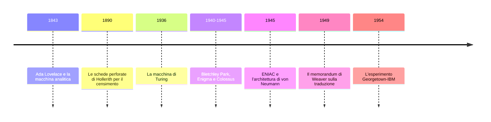
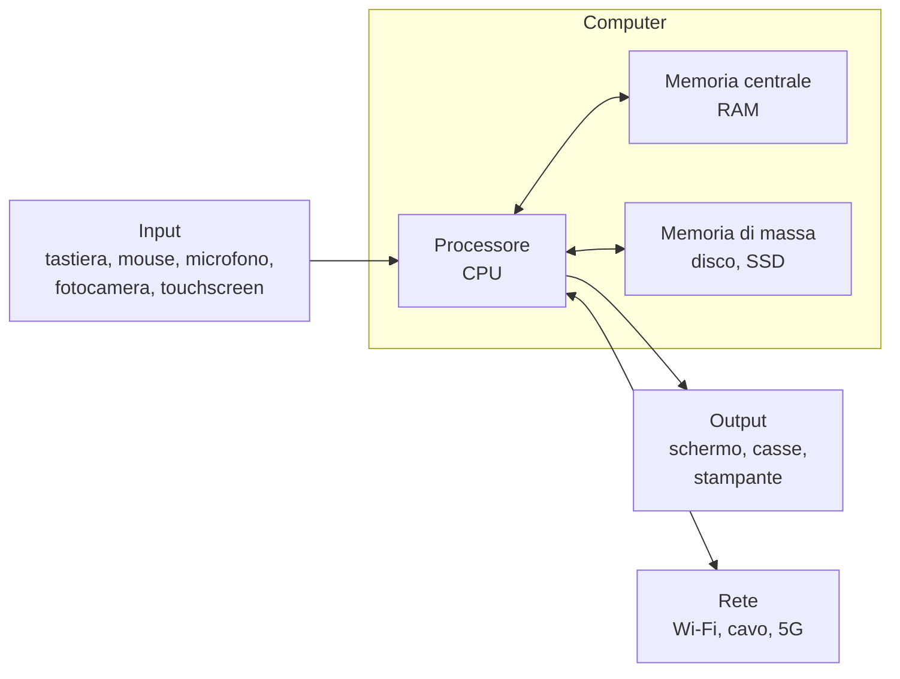

# L01 · Dati e macchine

<p class="meta">In presenza · 2 ore · Blocco A — Fondamenti</p>

!!! abstract "In sintesi"
    Questa prima lezione parte da una domanda semplice: che cosa sono i dati, e perché ce ne
    occupiamo? Partiremo da un'epidemia di colera nella Londra del 1854, vedremo che cosa si fa con i
    dati nello studio delle lingue e ci soffermeremo sull'operazione più difficile di tutte: trasformare
    qualcosa che una macchina non sa trattare (una frase, una registrazione, un documento) in qualcosa
    che può elaborare. Attraverso una breve storia che va da Ada Lovelace alla decrittazione di Enigma
    arriveremo alla traduzione automatica, e poi alle basi: come si danno istruzioni a un computer, che
    cosa sono hardware e software e quali forme prende il software. Chiuderemo con due esempi dal vivo,
    Wikidata e il corpus DiaCORIS.

<div class="slides-embed">
  <iframe src="../../slides/L01.html" title="Slide della lezione 1" loading="lazy" allowfullscreen></iframe>
</div>
<p class="slides-links">
  <a class="md-button" href="../../slides/L01.html" target="_blank" rel="noopener">Slide a schermo intero</a>
  <a class="md-button" href="../../slides/L01.pdf" target="_blank" rel="noopener">Slide in PDF</a>
</p>

## Obiettivi

Alla fine della lezione saprete:

- spiegare che cosa si intende per **dato** e per **dataset**, e perché nessun dato è del tutto neutrale;
- raccontare il caso della mappa del colera di John Snow e spiegare che cosa insegna sull'uso dei dati;
- descrivere che cosa si fa con i dati nello studio delle lingue: **corpora**, **annotazione**,
  modelli linguistici, processi automatici;
- spiegare perché rendere **computabile** un oggetto linguistico richiede una serie di scelte;
- collocare nel tempo alcune tappe fondamentali: Lovelace, Turing e Bletchley Park, Weaver e la
  traduzione automatica;
- distinguere **hardware** e **software** e riconoscere i principali tipi di interfaccia;
- riconoscere nel software tre componenti di base: **strutture dati**, **linguaggi di programmazione**
  e **linguaggi di marcatura**.

---

## 1. Da dove partiamo

### Il quiz

La lezione si apre con un quiz su **Kahoot**. Inquadrate il QR code proiettato in aula, oppure aprite
[kahoot.it](https://kahoot.it) sul telefono e inserite il PIN che compare sullo schermo. Potete usare
un soprannome: il quiz serve a capire che cosa la classe sa già su computer, web, dati, traduzione
automatica e intelligenza artificiale, e lo ripeteremo nell'ultima lezione per vedere che cosa è
cambiato. Nessuna risposta ha conseguenze sull'esame.

### Per alzata di mano

Alcune domande non hanno una risposta giusta o sbagliata, e le faremo per alzata di mano. Chi di voi…

1. sa che cosa sia la **linguistica computazionale**, anche solo a grandi linee?
2. conosce almeno un **linguaggio di programmazione** (Python, JavaScript, R), anche a livello elementare?
3. ha mai scritto o modificato una pagina in **HTML**?
4. ha mai usato un **corpus** linguistico (CORIS, BNC, Sketch Engine, un corpus parallelo)?
5. usa un **gestore bibliografico** come Zotero o Mendeley?
6. ha mai aperto il **terminale** del proprio computer?
7. usa abitualmente la **traduzione automatica** per studiare o per lavorare?
8. ha usato un **chatbot** (ChatGPT, Claude, Gemini) per preparare un esame o scrivere un testo?
9. tra quelli che lo usano, **verifica sempre** le informazioni che il chatbot fornisce?
10. ha un account su **GitHub**?

---

## 2. Che cosa sono i dati

### Una parola che sembra ovvia

Nell'immaginario comune i dati sono numeri: statistiche, percentuali, tabelle, grafici. In realtà la
parola copre un territorio molto più ampio. Sono dati anche una registrazione audio, la fotografia di
un documento, la trascrizione di un'intervista, l'elenco dei libri prestati da una biblioteca, la
cronologia delle ricerche su un motore di ricerca, i messaggi che vi scambiate ogni giorno.

*Dato* viene dal latino *datum*, participio passato di *dare*: letteralmente "ciò che è dato".
L'etimologia suggerisce un'idea precisa, cioè che i dati siano qualcosa che il mondo ci consegna già
pronto, indipendente da chi lo osserva, e quindi neutrale e oggettivo.

### Dati "presi", non "dati"

Le cose, però, sono meno semplici. Ogni dato esiste perché qualcuno ha deciso di **raccoglierlo**, ha
scelto **che cosa** registrare e **come** farlo, e ha usato uno strumento con i propri limiti. La
studiosa Johanna Drucker ha proposto, provocatoriamente, di sostituire la parola *data* con
***capta***, "ciò che è stato preso", proprio per ricordare che ogni dato è il risultato di un atto di
selezione e di interpretazione.

Pensate a un'operazione che sembra puramente meccanica: contare le parole di un testo. Per farlo bisogna
prima decidere che cosa sia una parola. *L'albero* è una parola o due? *Fine settimana* è una parola o
due? E *weekend*? *Glielo* è una parola sola o tre pronomi uniti? Diverse risposte producono conteggi
diversi, e tutte sono legittime. Il numero finale sembra oggettivo, ma incorpora una serie di scelte che
chi lo legge spesso non vede.

!!! tip "Una definizione di lavoro"
    In questo corso chiameremo **dati** le rappresentazioni di fenomeni (oggetti, eventi, testi,
    comportamenti) raccolte e organizzate per poter essere usate come **prove**: per descrivere,
    confrontare, spiegare, dimostrare qualcosa. Ciò che rende qualcosa un dato è l'uso che se ne fa.

### I dataset

I dati si raccolgono di solito in un **dataset**, cioè in una raccolta organizzata secondo criteri
precisi, pensata per sostenere un certo tipo di analisi o di interpretazione. Qualche esempio dal
mondo delle lingue:

- un **corpus**, cioè una raccolta di testi scritti o trascritti dal parlato, selezionati con criteri
  espliciti (periodo, genere, varietà di lingua) e organizzati per essere analizzati;
- un **dizionario elettronico**, in cui ogni voce è suddivisa in campi (lemma, categoria grammaticale,
  pronuncia, significati, esempi);
- un **corpus di apprendenti**, che raccoglie testi scritti da chi sta imparando una lingua straniera e
  ne annota gli errori;
- un **atlante linguistico**, che registra come si dice la stessa cosa in centinaia di località diverse;
- una **memoria di traduzione**, che conserva coppie di frasi già tradotte per riutilizzarle.

Quando incontrate un dataset, conviene sempre chiedersi chi lo ha costruito, con quali strumenti, con
quali criteri di selezione, che cosa ha escluso e per quale scopo. Le risposte a queste domande dicono
molto sui limiti di ciò che il dataset vi permette di concludere.

---

## 3. Perché servono i dati: Londra, 1854

### Un'epidemia nel quartiere di Soho

Tra la fine di agosto e l'inizio di settembre del 1854, nel quartiere londinese di Soho, un'epidemia di
colera uccise più di cinquecento persone in una decina di giorni. All'epoca la teoria più accreditata
sosteneva che il colera si trasmettesse attraverso i **miasmi**, cioè l'aria malsana che si sprigionava
dalla sporcizia e dai materiali in decomposizione.

Il medico **John Snow** non era convinto di questa spiegazione e sospettava che la malattia si
diffondesse attraverso l'acqua. Per verificarlo raccolse i dati sui decessi, casa per casa, e li
riportò su una mappa del quartiere, segnando ogni morte con una piccola barra nera in corrispondenza
dell'abitazione della vittima. Sulla stessa mappa indicò le pompe pubbliche da cui gli abitanti
attingevano l'acqua.

<figure markdown>
{ width="560" loading=lazy }
<figcaption>La mappa di John Snow (1854), pubblicata nella seconda edizione di <em>On the Mode of
Communication of Cholera</em> (1855). Pubblico dominio, via Wikimedia Commons.</figcaption>
</figure>

### Che cosa mostrava la mappa

Una volta disposti nello spazio, i dati mostravano qualcosa che l'elenco dei morti non rivelava: i
decessi si concentravano attorno alla pompa di **Broad Street**. Snow raccolse anche informazioni sulle
eccezioni, che si rivelarono decisive. Gli operai di una birreria vicina, che bevevano la birra prodotta
sul posto e non l'acqua della pompa, erano stati in gran parte risparmiati; lo stesso valeva per gli
ospiti di un ospizio dotato di un proprio pozzo. Al contrario, alcune vittime che abitavano lontano dal
quartiere avevano l'abitudine di farsi portare l'acqua proprio da Broad Street.

Snow presentò i suoi risultati alle autorità locali, che l'8 settembre fecero rimuovere la maniglia
della pompa. L'epidemia, che era già in fase di declino, si esaurì. Le indagini successive mostrarono
che il pozzo era stato contaminato da un pozzo nero che si trovava a pochi passi.

### Che cosa ci insegna

Il caso di Snow è diventato un classico della statistica, dell'epidemiologia e della visualizzazione
dei dati, e contiene alcune lezioni che valgono anche per noi:

- i **dati da soli non bastano**: lo stesso elenco di decessi era disponibile a chiunque, ma solo una
  certa organizzazione dei dati (la mappa) ha fatto emergere il fenomeno;
- serve una **domanda di ricerca**: Snow cercava una conferma alla sua ipotesi sull'acqua, e per questo
  ha registrato le pompe sulla mappa;
- le **eccezioni** contano quanto la regola: la birreria e l'ospizio hanno rafforzato la spiegazione più
  di qualsiasi conteggio;
- una correlazione nello spazio **non è ancora una prova**: Snow aveva bisogno di altre informazioni
  per dimostrare il legame causale, ed è proprio questo che ha cercato.

---

## 4. Che cosa ce ne facciamo dei dati quando studiamo le lingue

### Il macroscopio

Il microscopio permette di vedere ciò che è troppo piccolo per l'occhio umano. Per descrivere gli
strumenti che fanno il contrario, cioè che permettono di vedere ciò che è troppo **grande**, troppo
**lento** o troppo **complesso** per essere colto a colpo d'occhio, la studiosa Katy Börner ha usato la
parola **macroscopio**. Un macroscopio può essere un dataset, un software, un metodo di analisi: ciò che
conta è che sintetizzi molti elementi in relazione tra loro e faccia emergere tendenze, casi
particolari, eccezioni.

Nello studio delle lingue i dati servono soprattutto a tre cose:

- **organizzare** grandi quantità di materiali, in modo da poterli ritrovare, consultare e confrontare;
- **cercare pattern**, cioè regolarità e tendenze che nessuno potrebbe notare leggendo un testo alla
  volta: quali parole compaiono insieme, come cambia l'uso di una costruzione nel tempo, in che cosa
  differiscono due varietà di una lingua;
- condurre **analisi su larga scala**, su milioni o miliardi di parole, che permettono di verificare
  ipotesi formulate a partire da pochi esempi.

### La linguistica dei corpora

In linguistica queste operazioni sono al centro di un intero settore di studi, la **linguistica dei
corpora**, che descrive la lingua a partire dall'osservazione di grandi raccolte di testi reali invece
che da esempi inventati o dall'intuizione del parlante. È grazie ai corpora che i dizionari moderni
registrano le parole davvero in uso e con le accezioni davvero più frequenti, e che le grammatiche
possono dire quanto è diffusa una costruzione. Il British National Corpus, ad esempio, contiene circa
cento milioni di parole di inglese scritto e parlato del tardo Novecento.

Lo strumento più tipico è la **concordanza**, che mostra tutte le occorrenze di una parola con il
contesto immediato a destra e a sinistra, allineate al centro:

```text
             ...che non ha mai avuto |  paura  | di niente e di nessuno...
       ...la sera, quando aveva più |  paura  | , si chiudeva in camera...
          ...ci mise un po' a farsi |  paura  | da sola, poi rise...
              ...senza alcuna ombra |  paura  | ...
```

Leggendo decine o centinaia di righe come queste si capisce come una parola viene usata, con quali
verbi si combina (*avere paura*, *fare paura*, *mettere paura*), in quali registri compare.

### L'annotazione

Un corpus diventa molto più utile quando i testi sono **annotati**, cioè arricchiti con informazioni
esplicite aggiunte a ogni parola o a ogni frase. Le annotazioni più comuni indicano il **lemma** (la
forma di dizionario) e la **categoria grammaticale** (*part of speech*):

| Forma | Lemma | Categoria |
|---|---|---|
| Le | il | articolo |
| ragazze | ragazza | nome |
| avevano | avere | verbo ausiliare |
| visto | vedere | verbo |
| il | il | articolo |
| film | film | nome |

Grazie a questa annotazione si possono cercare tutte le forme di un verbo con una sola ricerca (il lemma
*vedere* trova *vedo*, *vide*, *visto*, *vedranno*), oppure tutte le sequenze "aggettivo + nome" per
studiare la posizione dell'aggettivo. L'annotazione può riguardare anche la sintassi, il significato, la
prosodia, gli errori, gli atti linguistici. Ogni livello di annotazione è a sua volta una forma di
interpretazione, e due annotatori possono non essere d'accordo.

### Modelli linguistici e processi automatici

A partire dai corpora si costruiscono anche i **modelli linguistici**, cioè rappresentazioni
statistiche di come funziona una lingua: quali parole sono probabili in un certo contesto, quali
combinazioni sono frequenti, quali rare. Sono modelli linguistici, di complessità molto diversa, quelli
che stanno dietro al completamento automatico della tastiera del telefono, al correttore ortografico,
alla traduzione automatica e ai chatbot. Ne parleremo a lungo nei Blocchi C e D. Per ora basta tenere a
mente un punto: **tutti questi sistemi imparano dai dati**, e quindi ereditano i pregi e i difetti dei
dataset su cui sono stati costruiti.

---

## 5. La parte difficile: rendere computabile

### Che cosa vuol dire

Un computer non sa che cosa sia una frase, una lettera scritta a mano o un messaggio vocale. Sa
soltanto eseguire operazioni su simboli rappresentati in forma numerica. Perché una macchina possa
lavorare su un oggetto linguistico, quell'oggetto deve essere trasformato in una forma che la macchina
può memorizzare e manipolare: in una parola, deve diventare **computabile**.

Questa trasformazione è l'operazione più complessa, e più delicata, di tutto il lavoro con i dati.
Prendiamo un esempio quotidiano: un messaggio vocale che un'amica vi manda in spagnolo.

1. **Registrare.** Il suono, che è un fenomeno continuo, viene misurato migliaia di volte al secondo e
   trasformato in una sequenza di numeri (lo vedremo nella L02).
2. **Trascrivere.** Un sistema di riconoscimento vocale, o una persona, trasforma il suono in testo.
   Si perdono l'intonazione, le pause, l'ironia nella voce; bisogna decidere come trattare le parole
   pronunciate a metà, le esitazioni, le parole in un'altra lingua.
3. **Codificare.** Ogni carattere del testo diventa un numero secondo una tabella condivisa (L02).
4. **Strutturare.** Si decide come organizzare le informazioni: il testo del messaggio, la data, chi
   l'ha inviato, la lingua (L03).
5. **Annotare.** Si aggiungono informazioni esplicite: le parti del discorso, il lemma di ogni parola,
   magari il tono del messaggio.
6. **Elaborare.** Solo a questo punto un programma può cercare, contare, tradurre, classificare (L04).

A ogni passaggio qualcosa si perde e qualcosa si guadagna, e ogni passaggio richiede delle scelte.
Saperlo è il primo passo per usare con giudizio qualunque strumento digitale che lavori sulle lingue.

---

## 6. Dai simboli alle macchine: una breve storia

### Ada Lovelace e la macchina analitica

Negli anni Trenta dell'Ottocento il matematico inglese **Charles Babbage** progettò la **macchina
analitica**, un calcolatore meccanico programmabile tramite schede perforate, che non fu mai
completato. Nel 1843 **Ada Lovelace** tradusse in inglese un articolo dell'ingegnere italiano Luigi
Federico Menabrea che descriveva la macchina, e vi aggiunse una serie di note molto più lunghe del
testo originale. In una di queste note descrisse un procedimento per far calcolare alla macchina una
serie di numeri (i numeri di Bernoulli), che è spesso considerato il primo programma della storia.

Ma l'intuizione più importante di Lovelace è un'altra. La macchina, osservava, non è limitata ai
numeri: può operare su **qualsiasi simbolo**, purché le relazioni tra i simboli possano essere espresse
in modo formale. Se si riuscisse a descrivere così i rapporti tra i suoni in armonia e composizione,
scriveva, la macchina potrebbe comporre musica. È esattamente l'idea che sta alla base di tutto ciò che
vedremo nel corso: qualunque cosa, una volta rappresentata con simboli e regole, può essere elaborata
da una macchina.

### Dati da contare: le schede perforate di Hollerith

Alla fine dell'Ottocento il censimento degli Stati Uniti richiedeva anni di lavoro manuale. Per quello
del 1890 l'ingegnere **Herman Hollerith** introdusse una macchina che leggeva le informazioni di ogni
cittadino registrate su **schede perforate**: la posizione di ogni foro corrispondeva a una
caratteristica (sesso, età, stato civile, luogo di nascita). L'elaborazione dei dati fu molto più rapida
che in passato. L'azienda fondata da Hollerith confluì in seguito in quella che sarebbe diventata IBM, e
le schede perforate rimasero il principale supporto per i dati fino agli anni Settanta del Novecento.

### Turing, Enigma e Bletchley Park

Nel 1936 il matematico inglese **Alan Turing** descrisse una macchina astratta, oggi chiamata
**macchina di Turing**, capace in linea di principio di eseguire qualsiasi procedimento di calcolo
descrivibile con regole precise. Era un modello teorico, ma fissava i concetti di algoritmo e di
calcolabilità su cui si fonda l'informatica.

Durante la Seconda guerra mondiale Turing lavorò a **Bletchley Park**, il centro britannico di
decrittazione, dove contribuì a progettare le *bombe*, macchine elettromeccaniche che aiutavano a
individuare le impostazioni giornaliere di **Enigma**, la macchina cifrante usata dalle forze armate
tedesche. Nello stesso centro entrò in funzione nel 1944 **Colossus**, uno dei primi calcolatori
elettronici, costruito per decifrare un altro sistema di cifratura tedesco.

La decrittazione è un caso esemplare di trasformazione di un problema linguistico in un problema di
calcolo. Un messaggio cifrato è un testo; per decifrarlo si sfruttavano le regolarità della lingua
(la frequenza delle lettere, le parole che ricorrevano spesso nei messaggi militari, le formule fisse
di saluto) per ridurre il numero di combinazioni da verificare a un numero che le macchine potevano
esplorare.

### Warren Weaver: tradurre come decifrare

Nel 1949 il matematico americano **Warren Weaver**, che durante la guerra aveva coordinato ricerche
scientifiche militari, fece circolare un memorandum intitolato semplicemente *Translation*. Weaver
proponeva di applicare alla traduzione le idee nate con la crittografia: davanti a un articolo in russo,
suggeriva, si può immaginare che sia in realtà scritto in inglese e poi "cifrato" con simboli strani, e
che tradurre significhi decifrarlo.

Il memorandum diede avvio alla ricerca sulla **traduzione automatica**. Nel 1954 una dimostrazione
pubblica organizzata dalla Georgetown University e da IBM tradusse automaticamente una sessantina di
frasi dal russo all'inglese, suscitando grandi aspettative. Le lingue si rivelarono però molto più
complesse di un codice cifrato, e i progressi furono lenti. L'idea di Weaver di trattare la lingua con
strumenti statistici sarebbe tornata, con risultati molto diversi, quarant'anni dopo. Seguiremo questa
storia nella L10.



---

## 7. Dare istruzioni a una macchina

### Istruzioni e interfacce

Per far fare qualcosa a una macchina bisogna darle delle **istruzioni**. Un insieme organizzato di
istruzioni, scritto in modo che la macchina possa eseguirlo, si chiama **programma**. Ma raramente
scriviamo programmi direttamente: di solito comunichiamo con il computer attraverso un'**interfaccia**,
cioè il punto di contatto tra una persona e una macchina, che traduce le nostre azioni in istruzioni.

Le interfacce sono cambiate molto nel tempo:

| Interfaccia | Come si danno le istruzioni | Diffusione |
|---|---|---|
| **Schede perforate** | si preparano le istruzioni su schede di cartoncino e si consegnano alla macchina | fino agli anni Settanta |
| **Riga di comando** | si scrivono comandi testuali in un terminale (`copy lettera.txt archivio`) | dagli anni Sessanta; ancora oggi usata da programmatori e tecnici |
| **Interfaccia grafica** | si usano finestre, icone, menu e un puntatore controllato dal mouse | dagli anni Ottanta |
| **Interfaccia touch** | si tocca e si trascina direttamente sullo schermo | dalla fine degli anni Duemila, con gli smartphone |
| **Interfaccia vocale** | si parla (*"imposta una sveglia alle sette"*) | dagli anni Dieci, con gli assistenti vocali |
| **Interfaccia conversazionale** | si scrive una richiesta in linguaggio naturale a un chatbot | dagli anni Venti, con i modelli linguistici |

L'ultima riga merita attenzione. Per la prima volta, la lingua in cui si danno istruzioni a una macchina
può essere una lingua naturale come l'italiano o lo spagnolo, con tutta la sua ambiguità. Saper
formulare una richiesta precisa a un modello linguistico è diventata una competenza linguistica, oltre
che tecnica, e ce ne occuperemo nella L14.

### Hardware e software

Qualunque sia l'interfaccia, dietro c'è sempre la stessa distinzione fondamentale:

- l'**hardware** è l'insieme delle componenti fisiche, ciò che si può toccare;
- il **software** è l'insieme dei programmi e dei dati, cioè le istruzioni e le informazioni su cui
  l'hardware lavora.

Un'analogia può aiutare: un libro stampato è un oggetto fatto di carta e inchiostro, mentre il testo
che contiene si può ristampare in un'altra edizione, leggere su un e-reader o ascoltare in un audiolibro
senza cambiare. Il libro fisico è l'hardware, il testo è il software. Lo stesso programma, allo stesso
modo, può funzionare su computer fisicamente diversi.

---

## 8. L'hardware

### Le componenti principali

Quasi tutti i computer, dal portatile allo smartphone, sono organizzati secondo lo schema descritto dal
matematico **John von Neumann** nel 1945:



- Il **processore** (CPU, *Central Processing Unit*) esegue le istruzioni dei programmi, una dopo
  l'altra, a una velocità di diversi miliardi di operazioni al secondo. Molti computer recenti hanno
  anche processori specializzati: la **GPU**, nata per la grafica e oggi fondamentale per
  l'intelligenza artificiale perché esegue moltissimi calcoli semplici in parallelo.
- La **memoria centrale** (RAM) contiene i programmi e i dati su cui il processore sta lavorando in quel
  momento. È velocissima ma **volatile**: si svuota quando il computer si spegne, ed è per questo che un
  documento non salvato va perso.
- La **memoria di massa** (disco rigido, SSD, chiavetta USB, scheda di memoria) conserva i dati in modo
  permanente. È più lenta della RAM, ma molto più capiente.
- I **dispositivi di input** (tastiera, mouse, microfono, fotocamera, touchscreen, sensori) portano le
  informazioni dentro il computer; quelli di **output** (schermo, altoparlanti, stampante) le restituiscono.
- I **dispositivi di rete** collegano il computer ad altri computer e a Internet.

### Molti tipi di computer

Quando pensiamo a un computer immaginiamo un portatile, ma oggi i computer sono ovunque:

- i **personal computer**, fissi e portatili;
- gli **smartphone** e i **tablet**, che contengono le stesse componenti miniaturizzate e molti sensori
  in più (GPS, accelerometro, sensore di impronte);
- i **server**, computer senza schermo né tastiera che forniscono servizi ad altri computer attraverso
  la rete. Raccolti a migliaia in grandi edifici, i **data center**, costituiscono quello che chiamiamo
  *cloud*;
- i **sistemi integrati** (*embedded*), piccoli computer nascosti dentro oggetti di uso quotidiano: la
  lavatrice, l'automobile, il bancomat, la carta di credito, la tessera dell'autobus;
- i **supercomputer**, usati per simulazioni scientifiche e per addestrare i grandi modelli di
  intelligenza artificiale. A Bologna, al Tecnopolo, si trova Leonardo, uno dei supercomputer più potenti
  d'Europa.

---

## 9. Il software

### Sistema operativo e applicazioni

Il software si divide in due grandi categorie. Il **sistema operativo** (Windows, macOS, Linux, Android,
iOS) è il programma che si avvia per primo, gestisce l'hardware e permette a tutti gli altri programmi
di funzionare. Le **applicazioni** sono i programmi che usiamo per svolgere compiti specifici: il
browser, il programma di videoscrittura, il lettore musicale, un'app di messaggistica. A queste si
aggiungono sempre più spesso i **servizi online**, applicazioni che funzionano su server remoti e a cui
accediamo tramite il browser o un'app.

### Che cosa c'è dentro il software

Se apriamo il software e guardiamo di che cosa è fatto, troviamo tre ingredienti che ci accompagneranno
per tutto il corso.

**Le strutture dati.** Sono i modi in cui le informazioni vengono organizzate. Ne conoscete già molte
senza saperlo: una **tabella**, come quelle di Excel, organizza i dati in righe e colonne; una
**lista**, come la lista della spesa o la playlist, li dispone in sequenza; un vocabolario associa a
ogni parola la sua definizione, ed è quello che in informatica si chiama **dizionario**; l'indice di un
libro, con capitoli, paragrafi e sottoparagrafi, è un **albero**; la mappa della metropolitana, con le
stazioni collegate dalle linee, è un **grafo**. Le vedremo da vicino nella L03.

**I linguaggi di programmazione.** Servono a descrivere **processi**, cioè sequenze di operazioni da
eseguire sui dati. Sono lingue artificiali, con un vocabolario ridotto e una grammatica rigidissima,
progettate per non essere ambigue. Ecco tre righe in **Python** che contano le parole di una frase:

```python
frase = "la lingua è un sistema in cui tutto si tiene"
parole = frase.split()
print(len(parole))   # stampa 10
```

La prima riga memorizza una frase, la seconda la divide in parole in corrispondenza degli spazi, la
terza stampa quante sono. Torneremo sulla programmazione nella L04.

**I linguaggi di marcatura.** Servono ad **annotare** un testo, aggiungendo informazioni sulla sua
struttura o sul suo significato attraverso dei marcatori, detti *tag*. Il più noto è **HTML**, il
linguaggio delle pagine web:

```html
<h1>Benvenuti</h1>
<p>Questa è la mia <strong>prima</strong> pagina web.</p>
```

Lo stesso principio si usa per annotare i corpora. In molti corpora, ad esempio, ogni parola è racchiusa
in un marcatore che ne indica il lemma e la categoria grammaticale:

```xml
<s>
  <w lemma="il" pos="DET">Le</w>
  <w lemma="ragazza" pos="NOUN">ragazze</w>
  <w lemma="avere" pos="AUX">avevano</w>
  <w lemma="vedere" pos="VERB">visto</w>
  <w lemma="il" pos="DET">il</w>
  <w lemma="film" pos="NOUN">film</w>
</s>
```

È la stessa tabella della sezione 4, scritta in una forma che un programma può leggere. Costruiremo una
pagina HTML nella L08.

---

## 10. Due esempi dal vivo

### Wikidata: informazioni strutturate

**Wikidata** è una base di conoscenza libera e collaborativa, nata nel 2012 come progetto gemello di
Wikipedia. Mentre Wikipedia contiene testi scritti per essere letti da persone, Wikidata contiene le
stesse conoscenze in forma di **dati strutturati**, che anche una macchina può interrogare.

Ogni entità ha un identificativo univoco che comincia con la lettera Q. La lingua italiana, ad esempio, è
[Q652](https://www.wikidata.org/wiki/Q652). La sua scheda contiene decine di affermazioni nella forma
*proprietà → valore*. Eccone alcune, in forma semplificata:

| Proprietà | Valore |
|---|---|
| sottoclasse di | lingue italo-dalmatiche |
| codice ISO 639-1 | `it` |
| codice ISO 639-3 | `ita` |
| sistema di scrittura | alfabeto latino |
| numero di parlanti | più valori, ciascuno con la fonte e l'anno della stima |

Ogni valore è a sua volta un'entità, con un proprio identificativo, e le etichette sono tradotte in
centinaia di lingue. Per questo Wikidata permette di porre domande che un'enciclopedia testuale non
consente di affrontare in modo diretto: quali lingue sono ufficiali in più di cinque paesi? quali lingue
romanze hanno meno di un milione di parlanti? Impareremo a porre queste domande nella L03.

### DiaCORIS: un corpus dell'italiano nel tempo

[**DiaCORIS**](https://corpora.ficlit.unibo.it/DiaCORIS/) è un corpus diacronico dell'italiano scritto,
sviluppato all'Università di Bologna. Copre il periodo dal **1861 al 2001**, diviso in cinque sezioni
(1861–1900, 1901–1922, 1923–1945, 1946–1967, 1968–2001), e comprende diversi sottocorpora: stampa
quotidiana, stampa periodica, narrativa, saggistica, prosa giuridica e una sezione miscellanea.
L'accesso è libero per scopi di ricerca.

Dalla pagina di interrogazione si può cercare una parola, scegliere il periodo e il sottocorpus e
ottenere la **concordanza** di tutte le occorrenze, ordinate secondo il contesto a destra o a sinistra.
Si possono anche calcolare le **collocazioni**, cioè le parole che compaiono insieme alla parola cercata
più spesso di quanto ci si aspetterebbe per caso.

!!! example "Esercizio (15 minuti, in coppia)"
    1. Aprite [DiaCORIS](https://corpora.ficlit.unibo.it/DiaCORIS/) e cercate la parola `calcolatore`
       prima nella sezione 1946–1967 e poi nella sezione 1968–2001. Fate lo stesso con `computer`.
       Che cosa notate?
    2. Scegliete una parola che secondo voi ha cambiato significato o frequenza nel corso del Novecento
       (*signorina*, *telefono*, *radio*, *automobile*, *macchina*, *ferie*) e osservatene le concordanze
       nei diversi periodi.
    3. Provate a calcolare le collocazioni della vostra parola. Quali parole la accompagnano più spesso?
       Cambiano da un periodo all'altro?
    4. Ricordando la sezione 2: chi ha scelto i testi di questo corpus? Che tipi di testo **non** ci
       sono? Che cosa potete concludere sull'italiano in generale, e che cosa no?

---

## Attività

**In aula**

1. Quiz su Kahoot e domande per alzata di mano.
2. Discussione sulla mappa di John Snow: che cosa avreste registrato voi? Che cosa poteva sfuggire alla
   mappa?
3. Esplorazione guidata della scheda di una lingua su Wikidata: scegliete la lingua che studiate e
   cercatene la scheda. Quali proprietà ci sono? Quali informazioni mancano o vi sembrano discutibili?
4. Esercizio su DiaCORIS.

**A casa (facoltativo, 20 minuti)**

Pensate a un dataset che vi piacerebbe avere per una ricerca nella lingua che studiate: un corpus, un
dizionario, una raccolta di registrazioni. Descrivete in poche righe che cosa conterrebbe, come
raccogliereste i dati, quali scelte dovreste fare per renderli computabili e che cosa rischiereste di
perdere.

---

## Mettetevi alla prova

**1.** La parola *dato* deriva dal latino *datum*. Perché alcuni studiosi preferiscono parlare di
*capta*?

- A. Perché i dati sono sempre numerici
- B. Per sottolineare che ogni dato è il risultato di una selezione e di un'interpretazione
- C. Perché i dati sono protetti dal diritto d'autore
- D. Perché i dati sono raccolti solo dalle macchine

??? success "Soluzione"
    **B.** *Capta* significa "ciò che è stato preso": raccogliere un dato implica sempre delle scelte.

**2.** Che cos'è un corpus linguistico?

- A. Un dizionario bilingue
- B. Una raccolta di testi selezionati con criteri espliciti e organizzati per essere analizzati
- C. Un programma di traduzione automatica
- D. Un manuale di grammatica

??? success "Soluzione"
    **B.**

**3.** Che cosa mostrò la mappa di John Snow del 1854?

- A. Che il colera si trasmetteva attraverso l'aria
- B. Che i decessi si concentravano attorno a una pompa dell'acqua
- C. Che il colera colpiva soprattutto i bambini
- D. Il percorso delle fognature di Londra

??? success "Soluzione"
    **B.** La pompa di Broad Street, nel quartiere di Soho.

**4.** In un corpus annotato, il **lemma** di *avevano* è:

- A. *avevano*
- B. *avere*
- C. verbo
- D. imperfetto

??? success "Soluzione"
    **B.** Il lemma è la forma di dizionario; *verbo* è la categoria grammaticale.

**5.** Quale intuizione è attribuita ad Ada Lovelace?

- A. Che le macchine possono pensare come gli esseri umani
- B. Che una macchina di calcolo può operare su qualsiasi simbolo, non solo sui numeri, se le relazioni tra i simboli sono formalizzate
- C. Che i computer devono usare il sistema binario
- D. Che la traduzione automatica è impossibile

??? success "Soluzione"
    **B.**

**6.** Nel memorandum del 1949, Warren Weaver proponeva di considerare la traduzione come:

- A. un problema di decifrazione
- B. un'arte che nessuna macchina potrà mai svolgere
- C. un problema di riconoscimento delle immagini
- D. un compito da affidare solo a traduttori umani

??? success "Soluzione"
    **A.** Un testo in russo veniva immaginato come un testo inglese "cifrato".

**7.** Quale di questi è un componente **hardware**?

- A. Il sistema operativo
- B. Il browser
- C. La memoria RAM
- D. Un file di testo

??? success "Soluzione"
    **C.**

**8.** Perché un documento non salvato va perso se manca la corrente?

- A. Perché si trova nella memoria di massa
- B. Perché si trova nella RAM, che è volatile
- C. Perché il processore lo cancella
- D. Perché il sistema operativo non lo riconosce

??? success "Soluzione"
    **B.**

**9.** HTML è:

- A. un linguaggio di programmazione
- B. un linguaggio di marcatura
- C. un sistema operativo
- D. un formato di immagine

??? success "Soluzione"
    **B.** Serve ad annotare la struttura di una pagina web, non a descrivere un processo.

**10.** Un chatbot a cui si scrivono richieste in italiano è un esempio di:

- A. interfaccia a riga di comando
- B. interfaccia grafica
- C. interfaccia conversazionale
- D. hardware

??? success "Soluzione"
    **C.**

---

## Per approfondire

- Drucker, J. (2011). Humanities approaches to graphical display. *Digital Humanities Quarterly*, 5(1).
  [Testo online](https://www.digitalhumanities.org/dhq/vol/5/1/000091/000091.html)
- Börner, K. (2011). Plug-and-play macroscopes. *Communications of the ACM*, 54(3), 60–69.
  [doi:10.1145/1897852.1897871](https://doi.org/10.1145/1897852.1897871)
- Johnson, S. (2006). *The Ghost Map: The Story of London's Most Terrifying Epidemic*. Riverhead Books.
  La storia dell'epidemia di Soho raccontata come un romanzo.
- Vrandečić, D., & Krötzsch, M. (2014). Wikidata: A free collaborative knowledgebase.
  *Communications of the ACM*, 57(10), 78–85. [doi:10.1145/2629489](https://doi.org/10.1145/2629489)

Elenco completo in [Letture e materiali](../letture.md#blocco-a-fondamenti).

## Parole chiave

[Dato](../glossario.md#dato) ·
[Dataset](../glossario.md#dataset) ·
[Corpus](../glossario.md#corpus) ·
[Annotazione](../glossario.md#annotazione) ·
[Concordanza](../glossario.md#concordanza) ·
[Lemma](../glossario.md#lemma) ·
[Computabile](../glossario.md#computabile) ·
[Interfaccia](../glossario.md#interfaccia) ·
[Hardware](../glossario.md#hardware) ·
[Software](../glossario.md#software) ·
[Sistema operativo](../glossario.md#sistema-operativo) ·
[Struttura dati](../glossario.md#struttura-dati) ·
[Linguaggio di programmazione](../glossario.md#linguaggio-di-programmazione) ·
[Linguaggio di marcatura](../glossario.md#linguaggio-di-marcatura) ·
[Wikidata](../glossario.md#wikidata)
