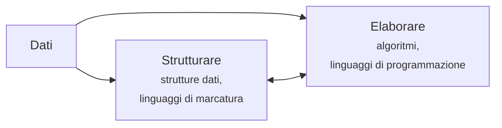
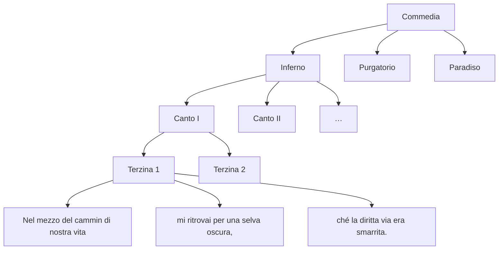
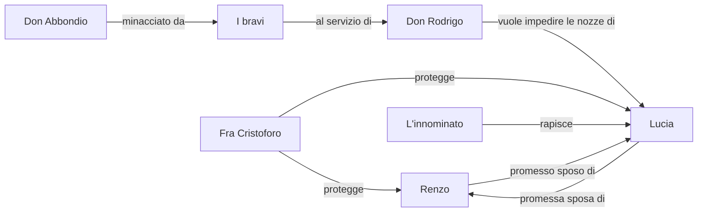
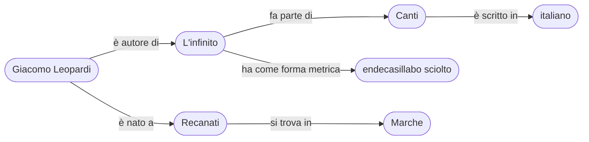

# L03 · Strutturare i dati

<p class="meta">In presenza · 2 ore · Blocco A — Fondamenti</p>

!!! abstract "In sintesi"
    Nella L02 abbiamo visto come si rappresentano i singoli dati: un numero, una lettera, un pixel.
    Ma un elenco di parole, un dizionario, la struttura di un libro o la rete dei personaggi di un
    romanzo richiedono di organizzare molti dati insieme, stabilendo relazioni tra di essi. In questa
    lezione conosciamo le principali **strutture dati**, i formati con cui si scrivono (CSV, JSON, XML),
    i **linguaggi di marcatura** con cui si annotano i documenti e i **grafi di conoscenza**, che
    permettono alle macchine di collegare tra loro concetti, persone, opere e luoghi. Lavoreremo su un
    esempio che non ha bisogno di presentazioni: gli spaghetti aglio, olio e peperoncino.

<div class="slides-embed">
  <iframe src="../../slides/L03.html" title="Slide della lezione 3" loading="lazy" allowfullscreen></iframe>
</div>
<p class="slides-links">
  <a class="md-button" href="../../slides/L03.html" target="_blank" rel="noopener">Slide a schermo intero</a>
  <a class="md-button" href="../../slides/L03.pdf" target="_blank" rel="noopener">Slide in PDF</a>
</p>

## Obiettivi

Alla fine della lezione saprete:

- spiegare la differenza tra **strutturare** ed **elaborare** i dati;
- riconoscere e usare le strutture dati fondamentali: **lista**, **dizionario**, **tabella**, **albero**, **grafo**;
- leggere e scrivere un semplice file **CSV**, **JSON** e **XML**;
- descrivere che cos'è un **linguaggio di marcatura** e usarne la sintassi di base (tag, elementi, attributi);
- rappresentare un insieme di informazioni come **grafo di conoscenza**, con triple *soggetto–predicato–oggetto*;
- riflettere sulle scelte, e sulle esclusioni, che ogni struttura comporta.

---

## 1. Strutturare ed elaborare

Davanti a un insieme di dati, qualunque sia la loro forma, un sistema informatico può fare
fondamentalmente due cose:

- **strutturarli**, cioè organizzarli secondo uno schema, attraverso una *struttura dati* o un
  *linguaggio di marcatura*;
- **elaborarli**, cioè trasformarli attraverso una procedura, un *algoritmo*, scritto di solito in un
  *linguaggio di programmazione*.

Le due attività sono strettamente legate. Un algoritmo lavora sempre su dati organizzati in un certo
modo, e la scelta della struttura determina quali operazioni saranno semplici e quali difficili.
Cercare una parola in un elenco ordinato alfabeticamente è facile; cercarla in un elenco disordinato
richiede di scorrerlo tutto. A loro volta, gli algoritmi possono modificare le strutture: aggiungere
voci, riordinarle, collegarle. Ogni sistema informatico ha bisogno di entrambe le componenti.



In questa lezione ci occupiamo della prima metà; la seconda è l'argomento della L04.

---

## 2. Le strutture dati fondamentali

Una **struttura dati** è un modo sistematico di organizzare e memorizzare i dati, in modo da poterli
ritrovare e manipolare in modo efficiente. Ne esistono moltissime; ne vediamo cinque, che bastano a
descrivere la maggior parte delle situazioni che incontrerete.

### La lista

Una **lista** (in molti linguaggi chiamata anche *array* o *vettore*) è una sequenza **ordinata** di
elementi. Ogni elemento occupa una posizione precisa, indicata da un numero detto **indice**. Nella
maggior parte dei linguaggi di programmazione il primo elemento ha indice 0, non 1.

```text
versi = [ "Sempre caro mi fu quest'ermo colle,",
          "e questa siepe, che da tanta parte",
          "dell'ultimo orizzonte il guardo esclude." ]

versi[0]  →  "Sempre caro mi fu quest'ermo colle,"
versi[2]  →  "dell'ultimo orizzonte il guardo esclude."
```

Le liste sono adatte a tutto ciò che ha un ordine significativo: i versi di una poesia, le parole di
una frase, i capitoli di un libro, la cronologia delle opere di un autore. Possono contenere duplicati:
nella lista delle parole dell'*Infinito*, la congiunzione *e* comparirà undici volte.

### Il dizionario

Un **dizionario** (detto anche *mappa*, *tabella associativa* o, in Python, `dict`) è un insieme di
coppie **chiave → valore**. Le chiavi sono uniche e servono a ritrovare rapidamente il valore
corrispondente, come la parola-lemma in un vocabolario permette di trovare la definizione.

```text
lemmi = { "corro":   "correre",
          "corsero": "correre",
          "andai":   "andare",
          "vado":    "andare",
          "uomini":  "uomo" }

lemmi["corsero"]  →  "correre"
```

Questa struttura è alla base di moltissimi strumenti linguistici: un lemmatizzatore associa ogni forma
flessa al proprio lemma, un glossario bilingue associa un termine alla sua traduzione, un indice dei
nomi associa ogni persona alle pagine in cui è citata.

### La tabella

Una **tabella** organizza i dati in **righe** e **colonne**. Ogni riga descrive un oggetto (un testo,
una persona, un'occorrenza) e ogni colonna un suo attributo. È la struttura dei fogli di calcolo come
Excel, LibreOffice Calc o Google Fogli, e quella delle basi di dati relazionali.

| id | autore | titolo | anno | lingua | genere |
|---|---|---|---|---|---|
| 1 | Giacomo Leopardi | L'infinito | 1819 | italiano | lirica |
| 2 | Alessandro Manzoni | I promessi sposi | 1827 | italiano | romanzo |
| 3 | Gustave Flaubert | Madame Bovary | 1857 | francese | romanzo |
| 4 | Rosalía de Castro | Cantares gallegos | 1863 | galiziano | lirica |

Una tabella come questa è il modo più comune di descrivere i **metadati** di un corpus: per ogni testo
si registrano autore, data, lingua, genere, fonte, e così via. Ogni colonna dovrebbe contenere dati di
un solo tipo e in un formato coerente: se in una riga l'anno è scritto `1827` e in un'altra
`metà Ottocento`, nessun programma potrà ordinare i testi cronologicamente.

### L'albero

Un **albero** è una struttura **gerarchica**: ogni elemento (detto *nodo*) può avere dei "figli", e ogni
nodo, tranne il primo, la *radice*, ha esattamente un "genitore". Gli alberi sono ovunque:

- la struttura di un'opera: la *Commedia* si divide in tre cantiche, ogni cantica in canti, ogni canto
  in terzine, ogni terzina in versi;
- le cartelle e i file del vostro computer;
- l'albero sintattico di una frase, in cui il verbo principale governa il soggetto e i complementi;
- l'albero genealogico, almeno nella sua forma più semplice;
- la struttura di una pagina web, come vedremo nella L08.



### Il grafo

Un **grafo** è l'insieme più generale: un insieme di **nodi** collegati da **archi**, senza vincoli
gerarchici. Un nodo può avere un numero qualsiasi di collegamenti, e i collegamenti possono formare
cicli. Gli archi possono avere una direzione (A segue B, ma B non segue necessariamente A) e
un'etichetta che specifica il tipo di relazione.

Con un grafo si rappresentano bene le **reti**: le amicizie su un social network, i collegamenti tra
pagine web, la corrispondenza tra gli intellettuali di un'epoca, le relazioni tra i personaggi di un
romanzo.



### Quale struttura scegliere

| Struttura | Organizza | Domanda tipica | Esempio |
|---|---|---|---|
| Lista | sequenze ordinate | qual è il terzo elemento? | le parole di una frase |
| Dizionario | associazioni chiave–valore | qual è il valore per questa chiave? | forma → lemma |
| Tabella | oggetti con gli stessi attributi | quali righe soddisfano una condizione? | metadati di un corpus |
| Albero | gerarchie | che cosa contiene questo elemento? | capitoli e paragrafi di un libro |
| Grafo | reti di relazioni | come sono collegati questi elementi? | personaggi di un romanzo |

Nella realtà le strutture si combinano: una lista di dizionari, una tabella in cui una colonna contiene
liste, un albero i cui nodi sono collegati anche trasversalmente.

---

## 3. Scrivere i dati: CSV, JSON, XML

Una struttura dati vive nella memoria del computer mentre un programma la usa. Per salvarla su un file
o scambiarla con altri programmi bisogna scriverla in un **formato** testuale condiviso. Vediamo la
stessa informazione, i primi due testi della tabella precedente, in tre formati molto diffusi.

=== "CSV"

    ```text
    id,autore,titolo,anno,lingua,genere
    1,Giacomo Leopardi,L'infinito,1819,italiano,lirica
    2,Alessandro Manzoni,I promessi sposi,1827,italiano,romanzo
    ```

=== "JSON"

    ```json
    [
      {
        "id": 1,
        "autore": "Giacomo Leopardi",
        "titolo": "L'infinito",
        "anno": 1819,
        "lingua": "italiano",
        "genere": "lirica"
      },
      {
        "id": 2,
        "autore": "Alessandro Manzoni",
        "titolo": "I promessi sposi",
        "anno": 1827,
        "lingua": "italiano",
        "genere": "romanzo"
      }
    ]
    ```

=== "XML"

    ```xml
    <testi>
      <testo id="1">
        <autore>Giacomo Leopardi</autore>
        <titolo>L'infinito</titolo>
        <anno>1819</anno>
        <lingua>italiano</lingua>
        <genere>lirica</genere>
      </testo>
      <testo id="2">
        <autore>Alessandro Manzoni</autore>
        <titolo>I promessi sposi</titolo>
        <anno>1827</anno>
        <lingua>italiano</lingua>
        <genere>romanzo</genere>
      </testo>
    </testi>
    ```

### CSV

Il formato **CSV** (*Comma-Separated Values*) rappresenta una tabella in testo semplice: ogni riga del
file è una riga della tabella e i valori sono separati da virgole. È il formato di scambio più
semplice e universale, e qualsiasi foglio di calcolo lo apre e lo esporta.

La sua semplicità ha però dei costi:

- se un valore contiene una virgola (*"Manzoni, Alessandro"*) deve essere racchiuso tra virgolette;
- nelle versioni italiane di Excel il separatore predefinito è il punto e virgola, perché la virgola è
  usata come separatore decimale, e un CSV prodotto in Italia può aprirsi tutto in una colonna su un
  computer inglese;
- il file non dichiara la propria codifica, e un CSV in UTF-8 aperto con una versione di Excel che si
  aspetta Windows-1252 produce il *mojibake* che conosciamo dalla L02;
- i fogli di calcolo cercano di "interpretare" i valori: una sigla come `MAR1` o una data scritta in
  un formato inatteso possono essere convertite automaticamente in date, alterando i dati in modo
  silenzioso.

### JSON

**JSON** (*JavaScript Object Notation*) nasce nel mondo del web ed è oggi il formato più usato per lo
scambio di dati tra applicazioni. Si basa su due costrutti, che corrispondono esattamente alle
strutture viste sopra: le **liste**, tra parentesi quadre, e i **dizionari** (detti *oggetti*), tra
parentesi graffe. Rispetto al CSV permette di rappresentare strutture annidate, ad esempio un testo con
più autori o con una lista di parole chiave.

### XML

**XML** (*eXtensible Markup Language*) è un linguaggio di marcatura, di cui parliamo nella sezione
seguente. Rappresenta naturalmente gli **alberi** ed è molto usato per i documenti: le edizioni
digitali, i dizionari elettronici, i formati dei programmi di videoscrittura (ricordate il
`document.xml` dentro il file `.docx`?), molti standard bibliografici e archivistici.

---

## 4. I linguaggi di marcatura

### Una pratica antica

L'idea di "marcare" un testo con indicazioni sulla sua struttura o sulla sua presentazione è molto più
antica dell'informatica. I redattori delle tipografie annotavano a mano i manoscritti degli autori con
segni convenzionali: *questo va in corsivo*, *questo è un titolo*, *qui va a capo*. Il termine inglese
*markup* viene proprio da questa pratica.

Un **linguaggio di marcatura** è un sistema di convenzioni per annotare un documento inserendo nel
testo dei segni, detti **marcatori** o **tag**, che descrivono la struttura, il significato o la
presentazione delle sue parti. I marcatori sono distinguibili dal contenuto, e un programma può quindi
separare l'uno dall'altro.

Alcune tappe:

- **1986**: viene pubblicato lo standard **SGML**, un metalinguaggio per definire linguaggi di marcatura;
- **1991**: Tim Berners-Lee definisce **HTML**, il linguaggio delle pagine web, derivato da SGML;
- **1998**: il W3C pubblica **XML**, una versione semplificata e più rigorosa di SGML, che diventa lo
  standard per lo scambio di documenti strutturati;
- **2004**: nasce **Markdown**, un linguaggio di marcatura "leggero" pensato per essere leggibile anche
  senza essere elaborato. Le pagine di questo sito sono scritte in Markdown.

### La sintassi di base

In XML e in HTML un **elemento** è delimitato da un **tag di apertura** e da un **tag di chiusura**,
che ha lo stesso nome preceduto da una barra:

```xml
<titolo>L'infinito</titolo>
```

Un elemento può avere degli **attributi**, cioè informazioni aggiuntive scritte dentro il tag di apertura
nella forma `nome="valore"`:

```xml
<titolo lingua="it" tipo="principale">L'infinito</titolo>
```

Gli elementi si possono **annidare** uno dentro l'altro, formando un albero:

```xml
<poesia>
  <titolo>L'infinito</titolo>
  <autore>Giacomo Leopardi</autore>
  <testo>
    <verso n="1">Sempre caro mi fu quest'ermo colle,</verso>
    <verso n="2">e questa siepe, che da tanta parte</verso>
  </testo>
</poesia>
```

Un documento XML si dice **ben formato** quando rispetta alcune regole sintattiche: c'è un unico
elemento radice che contiene tutti gli altri, ogni tag aperto viene chiuso, gli elementi sono annidati
correttamente (non si può chiudere `<poesia>` prima di aver chiuso `<testo>`), i valori degli attributi
sono tra virgolette. Un documento si dice inoltre **valido** quando rispetta uno **schema**, cioè un
insieme di regole che stabilisce quali elementi sono ammessi, in quale ordine e con quali attributi.

### HTML e XML

HTML e XML condividono la stessa sintassi ma hanno scopi diversi. **HTML** dispone di un insieme
**fisso** di elementi, pensati per le pagine web (`<h1>` per i titoli, `<p>` per i paragrafi, `<a>`
per i collegamenti) e interpretati dai browser per mostrare il documento. **XML** non ha elementi
predefiniti: è un linguaggio **estensibile**, con cui ciascuna comunità può definire i propri marcatori
in base a ciò che vuole descrivere.

Per i testi letterari e linguistici, lo schema XML più importante è quello della **TEI** (*Text
Encoding Initiative*), sviluppato dal 1987 per codificare manoscritti, edizioni critiche, testi poetici
e teatrali, dizionari, trascrizioni del parlato. In TEI una terzina dantesca si codifica così:

```xml
<lg type="terzina">
  <l n="1">Nel mezzo del cammin di nostra vita</l>
  <l n="2">mi ritrovai per una selva oscura,</l>
  <l n="3">ché la diritta via era smarrita.</l>
</lg>
```

dove `lg` (*line group*) indica un gruppo di versi e `l` (*line*) un singolo verso.

### Marcatura di presentazione e marcatura descrittiva

Si distingue tra marcatura **di presentazione**, che indica come una porzione di testo deve apparire
("in corsivo"), e marcatura **descrittiva**, che dice che cosa quella porzione di testo **è**
("titolo di un'opera", "parola straniera", "citazione"). In un libro stampato il corsivo può indicare
cose molto diverse: un titolo, un termine in lingua straniera, un'enfasi. Una marcatura descrittiva
conserva questa distinzione, e permette ad esempio di estrarre automaticamente tutti i titoli di opere
citati in un saggio, o tutte le parole straniere usate da un autore.

!!! example "Esercizio 1: aglio, olio e peperoncino (15 minuti)"
    Ecco una ricetta in testo libero:

    > Cuocete 320 g di spaghetti in abbondante acqua salata. Nel frattempo, in una padella larga,
    > scaldate 6 cucchiai di olio extravergine d'oliva con 4 spicchi d'aglio tagliati a fettine e
    > 1 peperoncino fresco sminuzzato, finché l'aglio non diventa dorato. Scolate la pasta al dente
    > tenendo da parte un mestolo di acqua di cottura, versatela in padella e saltatela con l'acqua
    > e una manciata di prezzemolo tritato. Servite subito.

    Usando XML, strutturate **l'elenco degli ingredienti**, distinguendo per ciascuno la quantità,
    l'unità di misura e il nome. Inventate voi i nomi dei tag.

    Poi riflettete: come rappresentate *una manciata* o *abbondante acqua*? Che cosa fate con il sale,
    di cui non è indicata la quantità? E con *q.b.*, *quanto basta*, che nella cucina italiana è
    ovunque?

    ??? success "Una possibile soluzione"
        ```xml
        <ingredienti>
          <ingrediente>
            <quantita>320</quantita>
            <unita>g</unita>
            <nome>spaghetti</nome>
          </ingrediente>
          <ingrediente>
            <quantita>6</quantita>
            <unita>cucchiai</unita>
            <nome>olio extravergine d'oliva</nome>
          </ingrediente>
          <ingrediente>
            <quantita>4</quantita>
            <unita>spicchi</unita>
            <nome>aglio</nome>
          </ingrediente>
          <ingrediente>
            <quantita>1</quantita>
            <nome>peperoncino fresco</nome>
          </ingrediente>
          <ingrediente>
            <quantita tipo="approssimativa">una manciata</quantita>
            <nome>prezzemolo</nome>
          </ingrediente>
          <ingrediente>
            <quantita tipo="non specificata"/>
            <nome>sale</nome>
          </ingrediente>
        </ingredienti>
        ```

        Notate l'uso dell'attributo `tipo` per distinguere le quantità precise da quelle approssimative,
        e l'elemento vuoto `<quantita/>`, che si apre e si chiude da solo. Non esiste un'unica soluzione
        corretta: ogni schema è una scelta su che cosa sia importante descrivere.

---

## 5. I grafi di conoscenza

### Dalla tabella al grafo

Le tabelle funzionano bene quando tutti gli oggetti hanno gli stessi attributi. Ma la conoscenza reale
è più irregolare: un autore può avere più nomi, scrivere in più lingue, aver vissuto in più città, e
le sue opere possono essere state tradotte, adattate, citate da altre opere. Per rappresentare questo
intreccio di relazioni si usa sempre più spesso un **grafo di conoscenza** (*knowledge graph*).

### Le triple

Un grafo di conoscenza è composto da affermazioni elementari, dette **triple**, nella forma:

**soggetto → predicato → oggetto**

dove il soggetto e l'oggetto sono nodi del grafo (persone, opere, luoghi, concetti) e il predicato è
l'arco che li collega, cioè la relazione:

| Soggetto | Predicato | Oggetto |
|---|---|---|
| Giacomo Leopardi | è nato a | Recanati |
| Giacomo Leopardi | è autore di | L'infinito |
| L'infinito | fa parte di | Canti |
| L'infinito | ha come forma metrica | endecasillabo sciolto |
| Canti | è scritto in | italiano |
| Recanati | si trova in | Marche |

Ogni tripla aggiunge un arco al grafo, e l'insieme delle triple forma una rete che si può percorrere in
qualsiasi direzione: partendo da *Recanati* si arriva alle opere degli autori che vi sono nati, partendo
da *endecasillabo sciolto* a tutte le poesie che lo usano.



Wikidata, che abbiamo esplorato nella L01, è un grande grafo di conoscenza, con oltre cento milioni di
entità. Le proprietà come *data di nascita* (P569) o *occupazione* (P106) sono predicati, le entità
come *Mahmoud Darwish* (Q207720) sono nodi.

### Classi e proprietà: i due livelli del grafo

Un grafo di conoscenza ben costruito ha due livelli:

- il livello delle **asserzioni**, che contiene i fatti specifici: *Leopardi è autore dell'Infinito*;
- il livello **terminologico**, che definisce il vocabolario usato per esprimere quei fatti: quali
  **classi** di entità esistono (*Persona*, *Opera*, *Luogo*, *Forma metrica*) e quali **proprietà** le
  collegano, con quali vincoli (la proprietà *è autore di* collega una *Persona* a un'*Opera*, non un
  *Luogo* a una *Forma metrica*).

Il livello terminologico si chiama spesso **ontologia**, con un termine preso in prestito dalla
filosofia. La disciplina che si occupa di progettare questi vocabolari e di raccogliere le conoscenze
degli esperti per formalizzarle è l'**ingegneria della conoscenza** (*knowledge engineering*).

### Identificativi univoci

Perché un grafo funzioni, ogni nodo deve avere un **identificativo univoco**. "Leopardi" è ambiguo
(esistono altre persone con questo cognome, oltre al conte Monaldo, padre del poeta); un identificativo
come quello di Wikidata, o un indirizzo web stabile che identifica una persona in modo non ambiguo,
risolve il problema. Quando diverse istituzioni (biblioteche, archivi, musei) usano gli stessi
identificativi e pubblicano i propri grafi sul web, i dati si collegano tra loro: si parla allora di
**Linked Open Data**. Torneremo sugli identificativi nella L05, a proposito di bibliografia.

!!! example "Esercizio 2: la ricetta come grafo (20 minuti)"
    Rappresentate come grafo di conoscenza un piatto che sapete cucinare, o uno tipico della cultura
    della lingua che studiate. Usate queste classi e queste proprietà:

    | Classi | Proprietà |
    |---|---|
    | Piatto | *contiene* (Piatto → Ingrediente) |
    | Ingrediente | *appartiene alla cucina* (Piatto → Cucina) |
    | Cucina | *si prepara con* (Piatto → Metodo di cottura) |
    | Metodo di cottura | *ha sapore* (Ingrediente → Profilo aromatico) |
    | Profilo aromatico | *si abbina a* (Ingrediente → Ingrediente) |

    Scrivete almeno dieci triple, poi disegnate il grafo (a mano o con
    [draw.io](https://app.diagrams.net/)). Ecco l'inizio, per gli spaghetti aglio, olio e peperoncino:

    ```mermaid
    flowchart LR
        P([Spaghetti aglio, olio<br>e peperoncino]) -- contiene --> S([spaghetti])
        P -- contiene --> A([aglio])
        P -- contiene --> O([olio d'oliva])
        P -- contiene --> PE([peperoncino])
        P -- appartiene alla cucina --> C([cucina campana])
        P -- si prepara con --> M1([bollitura])
        P -- si prepara con --> M2([soffritto])
        PE -- ha sapore --> PI([piccante])
        A -- si abbina a --> O
    ```

    Domande per la discussione: quali relazioni avreste voluto esprimere ma non avete potuto con
    queste proprietà? Un piatto può appartenere a più cucine? Come rappresentereste una variante (con
    o senza pangrattato)?

---

## 6. Dai testi ai dati: un accenno al NLP

La maggior parte dell'informazione che ci interessa non si trova in tabelle o grafi, ma in **testi
non strutturati**: articoli, libri, lettere, trascrizioni. Esistono tecniche che cercano di estrarre
automaticamente dati strutturati dai testi, e appartengono al campo dell'**elaborazione del linguaggio
naturale** (NLP, *Natural Language Processing*) e della **linguistica computazionale**. Due di queste
tecniche sono particolarmente legate a quanto abbiamo visto oggi:

- il **riconoscimento delle entità nominate** (*Named Entity Recognition*, NER) individua nel testo i
  nomi di persone, luoghi, organizzazioni, date;
- l'**estrazione di relazioni** (*Relation Extraction*) cerca di capire quali relazioni il testo
  stabilisce tra quelle entità, producendo triple.

!!! example "Esercizio 3: estrazione a mano (10 minuti)"
    Leggete questo breve testo:

    > Giacomo Leopardi nacque a Recanati nel 1798. Nel 1822 si trasferì per alcuni mesi a Roma, ospite
    > dello zio Carlo Antici. Dal 1833 visse a Napoli insieme all'amico Antonio Ranieri, e lì morì nel
    > 1837.

    1. Sottolineate tutte le entità: persone, luoghi, date.
    2. Scrivete le triple che il testo vi permette di ricavare (ad esempio *Giacomo Leopardi – è nato
       a – Recanati*).
    3. Quali informazioni avete dovuto **dedurre**? Chi è "lo zio" di chi? A che cosa si riferisce
       "lì"? Sono esattamente le difficoltà che un sistema automatico deve affrontare, e che vedremo nel
       Blocco C.

---

## 7. Ogni struttura è una scelta

Progettare una struttura dati significa decidere che cosa conta e che cosa no. Le scelte possono
sembrare tecniche e neutrali, ma hanno conseguenze concrete su chi viene rappresentato correttamente
e chi no.

Un esempio che riguarda da vicino chi studia lingue sono i **nomi di persona**. Molti moduli online
prevedono due campi, *nome* e *cognome*, e danno per scontato che il nome venga prima. Ma in cinese,
giapponese, coreano e ungherese il cognome si scrive di solito per primo; in spagnolo e in portoghese
molte persone hanno due cognomi; in islandese la maggior parte delle persone ha un patronimico al posto
del cognome di famiglia; in molte culture esistono nomi composti da una sola parola. Un sistema
progettato con in mente soltanto i nomi italiani o inglesi costringe tutti gli altri a deformare il
proprio nome per poter compilare un modulo.

!!! question "Per discutere"
    Pensate ad altri campi che nei moduli sembrano ovvi: *sesso* con due sole opzioni, *indirizzo*
    con via e numero civico (che in molti luoghi non esistono), *lingua madre* con una sola scelta
    possibile. Che cosa succede alle persone che non rientrano nello schema? E quando quei dati
    servono ad addestrare un sistema automatico?

---

## Mettetevi alla prova

**1.** Quale struttura dati è più adatta a rappresentare l'associazione tra le forme flesse di un verbo
e il loro lemma?

- A. Una lista
- B. Un dizionario
- C. Un albero
- D. Un'immagine

??? success "Soluzione"
    **B.** Ogni forma (chiave) è associata al suo lemma (valore).

**2.** La suddivisione della *Commedia* in cantiche, canti, terzine e versi si rappresenta naturalmente con:

- A. un albero
- B. un dizionario
- C. un grafo non orientato
- D. un file CSV

??? success "Soluzione"
    **A.** È una struttura gerarchica, in cui ogni elemento è contenuto in un solo elemento superiore.

**3.** Quale problema è tipico dei file CSV?

- A. Non si possono aprire con un foglio di calcolo
- B. Non possono contenere numeri
- C. Non dichiarano la propria codifica né il separatore, e possono essere interpretati male
- D. Possono contenere soltanto una colonna

??? success "Soluzione"
    **C.**

**4.** In XML, l'espressione `<verso n="3">` contiene:

- A. un tag di chiusura
- B. un tag di apertura con un attributo
- C. un commento
- D. un errore di sintassi

??? success "Soluzione"
    **B.** `n` è il nome dell'attributo, `3` il suo valore.

**5.** Un documento XML è *ben formato* quando:

- A. è scritto in inglese
- B. rispetta le regole sintattiche, ad esempio ogni tag aperto è chiuso e gli elementi sono annidati correttamente
- C. contiene almeno dieci elementi
- D. è stato approvato dal W3C

??? success "Soluzione"
    **B.** La *validità* rispetto a uno schema è un requisito ulteriore.

**6.** Qual è la differenza principale tra HTML e XML?

- A. HTML ha un insieme fisso di elementi pensati per le pagine web, XML permette di definire i propri elementi
- B. XML è più antico di HTML
- C. HTML non usa i tag
- D. XML si usa solo per le immagini

??? success "Soluzione"
    **A.**

**7.** In un grafo di conoscenza, l'affermazione "Leopardi è autore dell'*Infinito*" è:

- A. una classe
- B. una tripla soggetto–predicato–oggetto
- C. un attributo XML
- D. una lista

??? success "Soluzione"
    **B.** *Leopardi* è il soggetto, *è autore di* il predicato, *L'infinito* l'oggetto.

**8.** Il riconoscimento delle entità nominate (NER) serve a:

- A. tradurre automaticamente i nomi propri
- B. individuare in un testo nomi di persone, luoghi, organizzazioni e date
- C. correggere gli errori di ortografia
- D. comprimere i file di testo

??? success "Soluzione"
    **B.**

---

## Per approfondire

- Hogan, A., Blomqvist, E., Cochez, M., d'Amato, C., de Melo, G., Gutierrez, C., et al. (2021).
  Knowledge Graphs. *ACM Computing Surveys*, 54(4), 1–37.
  [doi:10.1145/3447772](https://doi.org/10.1145/3447772)
- Vrandečić, D., & Krötzsch, M. (2014). Wikidata: A free collaborative knowledgebase.
  *Communications of the ACM*, 57(10), 78–85. [doi:10.1145/2629489](https://doi.org/10.1145/2629489)
- [TEI by Example](https://teibyexample.org/): esercizi guidati sulla codifica dei testi in TEI.
- McKenzie, P. (2010). [*Falsehoods Programmers Believe About Names*](https://www.kalzumeus.com/2010/06/17/falsehoods-programmers-believe-about-names/).
  Un elenco celebre (e divertente) delle false certezze sui nomi di persona.

Elenco completo in [Letture e materiali](../letture.md#blocco-a-fondamenti).

## Parole chiave

[Struttura dati](../glossario.md#struttura-dati) ·
[Lista](../glossario.md#lista) ·
[Dizionario](../glossario.md#dizionario-struttura-dati) ·
[Tabella](../glossario.md#tabella) ·
[Albero](../glossario.md#albero) ·
[Grafo](../glossario.md#grafo) ·
[CSV](../glossario.md#csv) ·
[JSON](../glossario.md#json) ·
[XML](../glossario.md#xml) ·
[Linguaggio di marcatura](../glossario.md#linguaggio-di-marcatura) ·
[Tag](../glossario.md#tag) ·
[TEI](../glossario.md#tei-text-encoding-initiative) ·
[Grafo di conoscenza](../glossario.md#grafo-di-conoscenza) ·
[Tripla](../glossario.md#tripla) ·
[Ontologia](../glossario.md#ontologia) ·
[Linked Open Data](../glossario.md#linked-open-data) ·
[NER](../glossario.md#ner-named-entity-recognition)
