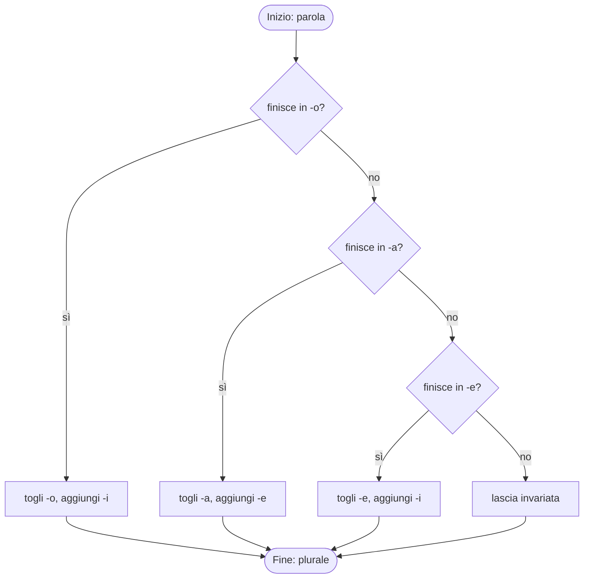
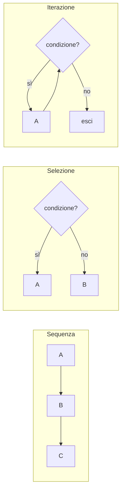

# L04 · Algoritmi e pensiero computazionale

<p class="meta">Online · 2 ore · Blocco A — Fondamenti</p>

!!! abstract "In sintesi"
    Nei giornali "l'algoritmo" è diventato quasi un personaggio, che decide che cosa vediamo sui social,
    chi ottiene un prestito, quali canzoni ci propone una piattaforma musicale. In questa lezione
    proviamo a capire che cosa sia, in senso proprio, un algoritmo, e impariamo a ragionare come chi deve
    dare istruzioni a una macchina: scomporre un problema, riconoscere delle regolarità, trascurare i
    dettagli irrilevanti e scrivere una procedura priva di ambiguità. Lo faremo con problemi che vi sono
    familiari: cucinare un piatto di pasta, formare il plurale dei nomi, ordinare le parole di un
    dizionario. Concluderemo con un primo sguardo a un vero linguaggio di programmazione.

<div class="slides-embed">
  <iframe src="../../slides/L04.html" title="Slide della lezione 4" loading="lazy" allowfullscreen></iframe>
</div>
<p class="slides-links">
  <a class="md-button" href="../../slides/L04.html" target="_blank" rel="noopener">Slide a schermo intero</a>
  <a class="md-button" href="../../slides/L04.pdf" target="_blank" rel="noopener">Slide in PDF</a>
</p>

## Obiettivi

Alla fine della lezione saprete:

- definire il **pensiero computazionale** e illustrarne i quattro principi con esempi concreti;
- dare una definizione precisa di **algoritmo** e riconoscerne le proprietà;
- rappresentare un algoritmo in linguaggio naturale, in **pseudocodice** e con un **diagramma di flusso**;
- usare le strutture di controllo fondamentali: **sequenza**, **selezione**, **iterazione**;
- leggere un breve programma in **Python** e capirne il funzionamento;
- spiegare perché le lingue naturali si prestano male a essere descritte soltanto con regole esplicite;
- confrontare l'efficienza di due algoritmi di ricerca.

---

## 1. Il pensiero computazionale

L'espressione *computational thinking* compare già negli anni Ottanta negli scritti di Seymour Papert,
il matematico e pedagogista che al MIT ideò il linguaggio Logo per insegnare ai bambini a programmare.
Divenne però popolare nel 2006, quando l'informatica Jeannette Wing la propose, in un breve articolo,
come un'abilità fondamentale che tutti dovrebbero acquisire, accanto a leggere, scrivere e far di
conto. Con questa espressione si indica un insieme di strategie per affrontare un problema in modo che
la soluzione possa essere eseguita, almeno in parte, da una macchina.

Di solito il pensiero computazionale si descrive attraverso quattro principi:

| Principio | Che cosa significa | Esempio linguistico |
|---|---|---|
| **Scomposizione** | dividere un problema complesso in sotto-problemi più semplici, da risolvere separatamente | tradurre un romanzo significa tradurre capitoli, e poi paragrafi, e poi frasi; ma anche mantenere coerenti i nomi dei personaggi in tutto il libro |
| **Riconoscimento di schemi** | individuare somiglianze e regolarità tra i sotto-problemi | i verbi italiani in *-are* si coniugano quasi tutti allo stesso modo |
| **Astrazione** | concentrarsi sulle caratteristiche rilevanti, trascurando le altre | per formare il plurale conta la vocale finale della parola, non il suo significato |
| **Algoritmo** | formulare una procedura ordinata e precisa che risolva il problema | le istruzioni passo per passo per formare il plurale |

!!! warning "Che cosa non è il pensiero computazionale"
    L'espressione si presta a fraintendimenti. Pensare in modo computazionale non vuol dire "pensare
    come un computer", né credere che ogni problema abbia una soluzione algoritmica. Michael Lodi e
    Simone Martini, in un articolo del 2021, hanno ricordato che nell'idea originale di Papert il
    computer era uno strumento per **imparare ed esprimersi**, non un modello della mente umana. Molti
    problemi che interessano gli umanisti, come interpretare una metafora o decidere come tradurre un
    gioco di parole, non hanno una soluzione di questo tipo, e non c'è alcuna ragione di forzarli in uno
    schema che non li rappresenta.

---

## 2. Che cos'è un algoritmo

### L'origine della parola

La parola *algoritmo* deriva dal nome del matematico persiano **Muḥammad ibn Mūsā al-Khwārizmī**,
attivo a Baghdad nel IX secolo. La traduzione latina di un suo trattato, che si apriva con le parole
*Dixit Algorizmi* ("così disse al-Khwārizmī"), fece conoscere in Europa i numeri indo-arabici e le
procedure per calcolare con essi. Da un'altra sua opera deriva anche la parola *algebra*.

### Una definizione

Un **algoritmo** è una sequenza **finita** di istruzioni **precise e non ambigue** che, a partire da un
insieme di dati iniziali (l'**input**), produce un risultato (l'**output**) in un numero finito di passi.

Le proprietà che un algoritmo deve avere sono quattro:

- **finitezza**: è composto da un numero finito di istruzioni e termina dopo un numero finito di passi;
- **non ambiguità**: ogni istruzione ha un solo significato possibile, e chi la esegue sa sempre che
  cosa fare;
- **eseguibilità**: ogni istruzione può essere effettivamente eseguita con i mezzi disponibili;
- **generalità**: risolve un'intera classe di problemi, e non soltanto un caso particolare.

### Algoritmi quotidiani

Eseguiamo algoritmi continuamente, anche senza chiamarli così: quando proviamo un paio di scarpe in un
negozio (provo la mia taglia; se è stretta provo quella più grande; se è larga quella più piccola;
mi fermo quando una mi va bene), quando seguiamo la routine della sera, quando montiamo un mobile
seguendo le istruzioni, quando cerchiamo una parola nel vocabolario.

La ricetta di cucina, che si cita spesso come esempio, è in realtà un algoritmo solo in parte. Un'istruzione come
"aggiungete sale quanto basta" non è un'istruzione precisa: *quanto basta* lo decide il cuoco, in base
al gusto e all'esperienza. Le ricette sono scritte per esseri umani, che colmano le lacune con il buon
senso. Un computer non ha buon senso, ed esegue **esattamente** ciò che c'è scritto.

!!! example "Esercizio 1: la ricetta per una macchina (15 minuti)"
    Riprendiamo gli spaghetti aglio, olio e peperoncino della L03. La prima istruzione della ricetta
    era *Cuocete 320 g di spaghetti in abbondante acqua salata*. Per una persona è chiarissima, ma per
    un robot che non ha mai visto una cucina va scomposta in passi elementari:

    1. prendi una pentola capiente;
    2. riempi la pentola d'acqua fino a tre quarti;
    3. metti la pentola sul fornello più grande;
    4. accendi il fornello alla fiamma massima;
    5. aspetta finché l'acqua non bolle;
    6. aggiungi 10 g di sale;
    7. …

    Continuate voi fino alla fine della ricetta, con la regola che ogni istruzione deve essere
    **un'azione semplice**, eseguibile senza bisogno di interpretazione. Poi scambiatevi i testi con un
    compagno, che li leggerà come se fosse il robot e segnalerà ogni punto in cui non saprebbe che cosa
    fare. Come si traduce *al dente* in un'istruzione? Che cosa fa il robot se il fornello non si accende?

    È esattamente il lavoro che si fa scrivendo un programma: scomporre un'attività in azioni
    elementari, che la macchina possa eseguire una dopo l'altra.

### Programma e linguaggio di programmazione

Un **programma** è un algoritmo scritto in un **linguaggio di programmazione**, cioè in una lingua che
un computer è in grado di eseguire. I linguaggi di programmazione (Python, JavaScript, Java, C, R e
moltissimi altri) sono **linguaggi formali**: hanno un vocabolario limitato e una grammatica rigida,
definita in modo da non ammettere ambiguità. Una frase sintatticamente scorretta, come una parentesi
non chiusa, non viene "capita lo stesso": il programma semplicemente non funziona.

!!! tip "Perché vi riguarda"
    "Ho visto l'uomo con il cannocchiale": chi ha il cannocchiale, io o l'uomo? "La vecchia porta la
    sbarra": chi porta che cosa? Le lingue naturali sono piene di ambiguità, sottintesi e dipendenze dal
    contesto, che i parlanti risolvono senza accorgersene. I linguaggi di programmazione sono progettati
    perché non ce ne siano. Gran parte della difficoltà dell'elaborazione automatica del linguaggio,
    che affronteremo nel Blocco C, nasce proprio dalla distanza tra questi due tipi di lingua.

---

## 3. Come si scrive un algoritmo

Lo stesso algoritmo si può scrivere in forme diverse, più o meno vicine al linguaggio della macchina.
Prendiamo un problema che conoscete bene: **formare il plurale di un nome italiano**.

### In linguaggio naturale

> Guarda l'ultima lettera della parola. Se è *-o*, sostituiscila con *-i*. Se è *-a*, sostituiscila
> con *-e*. Se è *-e*, sostituiscila con *-i*. Negli altri casi, lascia la parola invariata.

### In pseudocodice

Lo **pseudocodice** è una forma intermedia tra lingua naturale e linguaggio di programmazione: è
abbastanza preciso da non lasciare dubbi, ma resta leggibile da chiunque. Non esiste una sintassi
ufficiale, e ciascuno può adottare le convenzioni che preferisce, purché le usi in modo coerente.

```text
ALGORITMO plurale(parola)
    SE parola finisce con "o" ALLORA
        restituisci parola senza l'ultima lettera + "i"
    ALTRIMENTI SE parola finisce con "a" ALLORA
        restituisci parola senza l'ultima lettera + "e"
    ALTRIMENTI SE parola finisce con "e" ALLORA
        restituisci parola senza l'ultima lettera + "i"
    ALTRIMENTI
        restituisci parola          // es. "film", "bar", "città"
FINE
```

### Con un diagramma di flusso

Il **diagramma di flusso** rappresenta l'algoritmo in forma grafica: gli ovali indicano l'inizio e la
fine, i rettangoli le azioni, i rombi le decisioni, le frecce l'ordine in cui procedere.



### In Python

Ed ecco lo stesso algoritmo scritto in **Python**, uno dei linguaggi di programmazione più diffusi e
più usati nella linguistica computazionale e nelle Digital Humanities:

```python
def plurale(parola):
    if parola.endswith("o"):
        return parola[:-1] + "i"
    elif parola.endswith("a"):
        return parola[:-1] + "e"
    elif parola.endswith("e"):
        return parola[:-1] + "i"
    else:
        return parola

print(plurale("libro"))   # libri
print(plurale("casa"))    # case
print(plurale("film"))    # film
```

Non serve saper programmare per capirlo. `def` definisce una nuova funzione, chiamata `plurale`, che
riceve una `parola`. `if`, `elif` ("altrimenti se") ed `else` corrispondono a *se*, *altrimenti se* e
*altrimenti*. `parola[:-1]` significa "la parola senza l'ultimo carattere", e il segno `+` unisce due
sequenze di caratteri. Le righe che cominciano con `#` sono commenti, ignorati dal computer.

### Mettiamolo alla prova

| Parola | Risultato dell'algoritmo | Corretto? |
|---|---|---|
| libro | libri | ✅ |
| casa | case | ✅ |
| fiore | fiori | ✅ |
| film | film | ✅ |
| città | città | ✅ (ma solo perché *à* è un carattere diverso da *a*) |
| **amica** | amice | ❌ amiche |
| **lago** | lagi | ❌ laghi |
| **problema** | probleme | ❌ problemi |
| **mano** | mani | ✅ (ma *mano* è femminile: la regola funziona per caso) |
| **uomo** | uomi | ❌ uomini |
| **uovo** | uovi | ❌ uova |
| **dito** | diti | ❌ dita (o *diti*, in un altro senso) |

Possiamo aggiungere regole: *-ca* diventa *-che*, *-ga* diventa *-ghe*. Ma *amico* fa *amici* e
*antico* fa *antichi*; *mago* fa *maghi* e *psicologo* può fare *psicologi*. Le parole in *-ma* di
origine greca (*problema*, *tema*, *poema*) fanno il plurale in *-i*, ma *arma* fa *armi* e *mamma*
fa *mamme*. Alla fine ci serve un elenco di eccezioni, e l'elenco cresce ogni volta che proviamo
l'algoritmo su un testo nuovo.

!!! question "Per discutere"
    Questo è, in piccolo, il problema che hanno affrontato i primi sistemi di traduzione automatica,
    negli anni Cinquanta e Sessanta: le lingue hanno regole, ma le regole hanno eccezioni, e le
    eccezioni hanno a loro volta eccezioni. A partire dagli anni Novanta si è progressivamente cambiato
    approccio: invece di scrivere le regole a mano, si lascia che il sistema le ricavi da milioni di
    esempi. È il passaggio dalle regole alla statistica che studieremo nelle L10 e L12. Quali vantaggi
    ha un sistema a regole scritte da esperti? Quali svantaggi?

---

## 4. Le strutture di controllo

Qualunque algoritmo, per quanto complesso, si può costruire combinando tre soli tipi di istruzione,
detti **strutture di controllo**.

**La sequenza.** Le istruzioni vengono eseguite una dopo l'altra, nell'ordine in cui sono scritte:
*fai A, poi B, poi C*. La ricetta per il robot è quasi tutta una sequenza.

**La selezione** (o condizione). Si sceglie tra due o più strade a seconda che una condizione sia
vera o falsa: *se la condizione è vera fai A, altrimenti fai B*. L'algoritmo del plurale è costruito
quasi interamente con selezioni.

**L'iterazione** (o ciclo). Un gruppo di istruzioni viene ripetuto più volte: un numero stabilito di
volte, per ogni elemento di una lista, oppure finché una condizione resta vera. *Aspetta finché l'acqua
non bolle* è un'iterazione: controlla l'acqua, e se non bolle ancora aspetta e controlla di nuovo.

Per tenere traccia dei valori che cambiano durante l'esecuzione si usano le **variabili**, contenitori
dotati di un nome, il cui contenuto può essere letto e modificato.



### Un esempio che le usa tutte e tre

Contiamo quante volte compare ciascuna parola in un testo, come abbiamo fatto con *L'infinito* nella L01.
In pseudocodice:

```text
ALGORITMO conta_parole(testo)
    frequenze ← dizionario vuoto
    parole ← dividi testo in parole
    PER OGNI parola IN parole                    // iterazione
        parola ← trasforma parola in minuscolo   // sequenza
        SE parola è già in frequenze ALLORA      // selezione
            frequenze[parola] ← frequenze[parola] + 1
        ALTRIMENTI
            frequenze[parola] ← 1
    restituisci frequenze
FINE
```

E in Python:

```python
testo = "Sempre caro mi fu quest'ermo colle, e questa siepe, che da tanta parte"

frequenze = {}
for parola in testo.lower().replace(",", "").split():
    if parola in frequenze:
        frequenze[parola] += 1
    else:
        frequenze[parola] = 1

print(frequenze)
# {'sempre': 1, 'caro': 1, 'mi': 1, 'fu': 1, "quest'ermo": 1, 'colle': 1, 'e': 1, ...}
```

Notate due cose. La prima è che il programma usa un **dizionario**, la struttura dati della L03, per
associare a ogni parola il numero delle sue occorrenze. La seconda è che il programma tratta
*quest'ermo* come una sola parola, perché divide il testo soltanto in corrispondenza degli spazi:
decidere che cosa sia una "parola" è meno semplice di quanto sembri, e lo vedremo nel Blocco C a
proposito di **tokenizzazione**.

!!! info "Volete provare?"
    Non serve installare nulla. Potete eseguire questi esempi online, ad esempio su
    [Google Colab](https://colab.research.google.com/) (con un account Google) o su
    [JupyterLite](https://jupyter.org/try-jupyter/lab/), che funziona direttamente nel browser.
    Copiate il codice, premete il tasto di esecuzione e provate a cambiare il testo.

---

## 5. Ordinare e cercare: due problemi linguistici

### Che cosa significa "in ordine alfabetico"?

Ordinare un elenco di parole sembra il problema più banale del mondo, ma il concetto stesso di **ordine
alfabetico** varia da lingua a lingua:

- in **spagnolo** la *ñ* è una lettera distinta e si colloca dopo la *n*: *nuez*, *ñandú*, *oso*.
  Fino al 1994, inoltre, i dizionari della Real Academia trattavano *ch* e *ll* come lettere
  autonome, collocate rispettivamente dopo la *c* e dopo la *l*;
- in **svedese** *å*, *ä* e *ö* sono lettere a sé e si trovano **in fondo** all'alfabeto, dopo la *z*;
- in **tedesco** la *ä* si ordina come una *a* nei dizionari, ma negli elenchi di nomi (come gli
  elenchi telefonici) spesso come *ae*;
- in **ceco** il digramma *ch* è una lettera e viene dopo la *h*;
- in **giapponese** l'ordinamento segue il sillabario (l'ordine *gojūon*: a, i, u, e, o, ka, ki, ku…);
- per il **cinese** esistono più criteri: per pronuncia in *pinyin*, per numero di tratti, per radicale.

E per un computer che non riceve istruzioni specifiche, l'ordine è semplicemente quello dei punti di
codice Unicode visti nella L02. Così `Z` (90) viene prima di `a` (97), e `é` (233) viene dopo `z` (122):
un elenco come *zebra, Zurigo, école, abete* verrebbe ordinato come *Zurigo, abete, zebra, école*.

Per questo i sistemi informatici usano regole di **ordinamento** specifiche per ciascuna lingua,
dette in inglese *collation*. Unicode definisce un algoritmo di base, adattabile alle diverse
tradizioni.

### Ordinare: strategie diverse, costi diversi

Ricordate il gioco della L01, in cui vi siete messi in fila per data di nascita senza parlare? Era un
problema di **ordinamento**, e probabilmente avete usato una di queste strategie, che in informatica
hanno un nome preciso:

- **ordinamento a bolle** (*bubble sort*): ciascuno si confronta con il vicino e, se i due sono
  nell'ordine sbagliato, si scambiano di posto. Si ripete finché nessuno deve più spostarsi;
- **ordinamento per selezione** (*selection sort*): si cerca la persona più anziana e la si mette in
  testa, poi si cerca la più anziana tra le rimanenti e la si mette in seconda posizione, e così via;
- **ordinamento per inserimento** (*insertion sort*): ciascuno, a turno, entra nella fila già formata
  e si colloca al posto giusto, come quando si riordinano le carte da gioco in mano.

Tutte e tre producono il risultato corretto, ma con un numero di passi molto diverso al crescere del
numero di persone. Esistono algoritmi molto più efficienti, come il *merge sort* e il *quicksort*,
che usano la scomposizione: dividono l'elenco in due metà, le ordinano separatamente e poi le fondono.

### Cercare in un dizionario

Dovete trovare la parola *pesca* in un vocabolario di 1000 pagine. Avete due possibilità.

La **ricerca lineare** consiste nello sfogliare il dizionario dalla prima pagina, una pagina dopo
l'altra, finché non si trova la parola. Nel caso peggiore servono 1000 passi.

La **ricerca binaria** consiste nell'aprire il dizionario a metà e controllare se *pesca* venga prima
o dopo le parole di quella pagina. Si scarta così metà del dizionario e si ripete l'operazione sulla
metà rimasta: 1000 pagine, poi 500, 250, 125, 63, 32, 16, 8, 4, 2, 1. Bastano circa **10 passi**.

| Pagine del dizionario | Ricerca lineare (caso peggiore) | Ricerca binaria (caso peggiore) |
|---|---|---|
| 1.000 | 1.000 passi | 10 passi |
| 1.000.000 | 1.000.000 passi | 20 passi |
| 1.000.000.000 | 1.000.000.000 passi | 30 passi |

È proprio così che, intuitivamente, si consulta un vocabolario cartaceo. La ricerca binaria ha però
una condizione: funziona **soltanto se l'elenco è ordinato**. Ecco perché ordinare è un'operazione così
importante, e perché i motori di ricerca e le basi di dati dedicano tanto lavoro a costruire **indici**
ordinati in anticipo.

Questi esempi introducono una domanda centrale dell'informatica: non basta sapere *se* un problema si
può risolvere, bisogna sapere anche **quanto costa** risolverlo, in termini di tempo, di memoria e,
sempre più spesso, di energia.

---

## 6. "L'algoritmo" nel discorso pubblico

Quando un giornale parla dell'"algoritmo di TikTok" o dell'"algoritmo di Instagram", usa la parola in
senso largo. Non si riferisce a una procedura come quella del plurale, che si può leggere e verificare
riga per riga, ma a un **sistema** complesso, fatto di molti programmi e di modelli statistici
addestrati su enormi quantità di dati sul comportamento degli utenti. Spesso nessuno è in grado di
leggerne le regole: in alcuni casi perché sono segrete, protette come segreto industriale; in altri
perché il sistema le ha ricavate dai dati e non sono scritte da nessuna parte in forma comprensibile.

!!! question "Per discutere"
    Se un sistema automatico decide quali notizie vedete, chi è responsabile di ciò che vedete:
    chi lo ha progettato, chi lo ha addestrato, l'azienda che lo usa, voi che avete cliccato?
    E se un algoritmo esclude la vostra candidatura a un lavoro, avete diritto di sapere perché?
    Lasciamo aperta la domanda: tornerà quando parleremo del Web (L07) e di etica dell'intelligenza
    artificiale (L15).

---

## Attività

**Durante la lezione (online, in stanze da 3 o 4 persone)**

1. **La ricetta per il robot.** Riscrivete la ricetta degli spaghetti aglio, olio e peperoncino come
   sequenza di azioni elementari. Un compagno la "esegue" alla lettera e segnala ogni istruzione
   ambigua.
2. **Il plurale nella vostra lingua.** Scegliete la lingua che studiate e scrivete in pseudocodice un
   algoritmo per formare il plurale dei nomi, oppure un'altra regola morfologica (il genere dei
   sostantivi, il participio passato, il comparativo degli aggettivi). Provatelo su dieci parole, di
   cui almeno tre "difficili". Quante regole vi sono servite? Quante eccezioni avete trovato? Avete
   avuto bisogno di sapere qualcosa sulla parola oltre alla sua forma (il genere, l'origine, il
   significato)?
3. **Disegnatelo.** Trasformate il vostro algoritmo in un diagramma di flusso, su carta oppure con
   [draw.io](https://app.diagrams.net/).

**A casa (facoltativo)**

- Provate i primi livelli del *Labirinto* su [Blockly Games](https://blockly.games/?lang=it): è
  programmazione visuale, senza scrivere codice, e allena sequenza, selezione e iterazione.
- Aprite [Google Colab](https://colab.research.google.com/) o
  [JupyterLite](https://jupyter.org/try-jupyter/lab/), copiate la funzione `plurale` e provate a
  migliorarla aggiungendo la regola per le parole in *-ca* e *-ga*.

---

## Mettetevi alla prova

**1.** Quale di questi **non** è uno dei quattro principi del pensiero computazionale?

- A. Scomposizione
- B. Astrazione
- C. Memorizzazione
- D. Riconoscimento di schemi

??? success "Soluzione"
    **C.** I quattro principi sono scomposizione, riconoscimento di schemi, astrazione e algoritmi.

**2.** Un algoritmo deve essere:

- A. scritto in un linguaggio di programmazione
- B. finito, non ambiguo ed eseguibile
- C. eseguito da un computer
- D. il più breve possibile

??? success "Soluzione"
    **B.** Un algoritmo si può scrivere anche in lingua naturale o in pseudocodice, ed essere eseguito
    da una persona. Quando è scritto in un linguaggio di programmazione diventa un programma.

**3.** L'istruzione "aggiungete sale quanto basta" non è un'istruzione algoritmica perché:

- A. è scritta in italiano
- B. non è eseguibile da un essere umano
- C. è ambigua: la quantità dipende dall'interpretazione di chi la esegue
- D. riguarda la cucina

??? success "Soluzione"
    **C.**

**4.** Nell'istruzione "*Se* la parola finisce in -a, sostituisci con -e, *altrimenti* lasciala com'è"
si usa la struttura di:

- A. sequenza
- B. selezione
- C. iterazione
- D. variabile

??? success "Soluzione"
    **B.**

**5.** "Aspetta finché l'acqua non bolle" è un esempio di:

- A. sequenza
- B. selezione
- C. iterazione
- D. funzione

??? success "Soluzione"
    **C.** L'azione si ripete finché la condizione resta vera.

**6.** In un diagramma di flusso, il rombo rappresenta:

- A. l'inizio dell'algoritmo
- B. un'azione da compiere
- C. una decisione
- D. la fine dell'algoritmo

??? success "Soluzione"
    **C.**

**7.** In Python, che cosa restituisce `plurale("lago")` con la funzione vista a lezione?

- A. laghi
- B. lagi
- C. lago
- D. un errore

??? success "Soluzione"
    **B.** La funzione sostituisce la *o* finale con *i*, senza gestire il caso di *-go*.

**8.** Un computer che ordina parole senza regole specifiche per la lingua mette `Zurigo` prima di
`abete` perché:

- A. ordina le parole dalla più lunga alla più corta
- B. confronta i punti di codice dei caratteri, e le maiuscole hanno valori più bassi delle minuscole
- C. ordina le parole in ordine alfabetico inverso
- D. considera le parole straniere prima di quelle italiane

??? success "Soluzione"
    **B.** `Z` vale 90, `a` vale 97.

**9.** La ricerca binaria in un elenco di parole:

- A. funziona solo se l'elenco è ordinato
- B. è sempre più lenta della ricerca lineare
- C. controlla le parole una alla volta dall'inizio
- D. funziona solo con i numeri

??? success "Soluzione"
    **A.**

**10.** Con la ricerca binaria, quanti passi servono al massimo, approssimativamente, per trovare una
parola in un elenco ordinato di un milione di voci?

- A. 20
- B. 1.000
- C. 500.000
- D. 1.000.000

??? success "Soluzione"
    **A.** Ogni passo dimezza l'elenco: 2<sup>20</sup> è poco più di un milione.

---

## Per approfondire

- Wing, J. M. (2006). Computational thinking. *Communications of the ACM*, 49(3), 33–35.
  [doi:10.1145/1118178.1118215](https://doi.org/10.1145/1118178.1118215)
- Lodi, M., & Martini, S. (2021). Computational thinking, between Papert and Wing. *Science &
  Education*, 30(4), 883–908. [doi:10.1007/s11191-021-00202-5](https://doi.org/10.1007/s11191-021-00202-5)
- Denning, P. J., & Tedre, M. (2019). *Computational Thinking*. MIT Press.
- [CS Unplugged](https://www.csunplugged.org/): attività per imparare i concetti dell'informatica senza computer.

Elenco completo in [Letture e materiali](../letture.md#blocco-a-fondamenti).

## Parole chiave

[Pensiero computazionale](../glossario.md#pensiero-computazionale) ·
[Algoritmo](../glossario.md#algoritmo) ·
[Programma](../glossario.md#programma) ·
[Linguaggio formale](../glossario.md#linguaggio-formale) ·
[Pseudocodice](../glossario.md#pseudocodice) ·
[Diagramma di flusso](../glossario.md#diagramma-di-flusso) ·
[Strutture di controllo](../glossario.md#strutture-di-controllo) ·
[Variabile](../glossario.md#variabile) ·
[Python](../glossario.md#python) ·
[Ordinamento](../glossario.md#ordinamento) ·
[Ricerca binaria](../glossario.md#ricerca-binaria)
