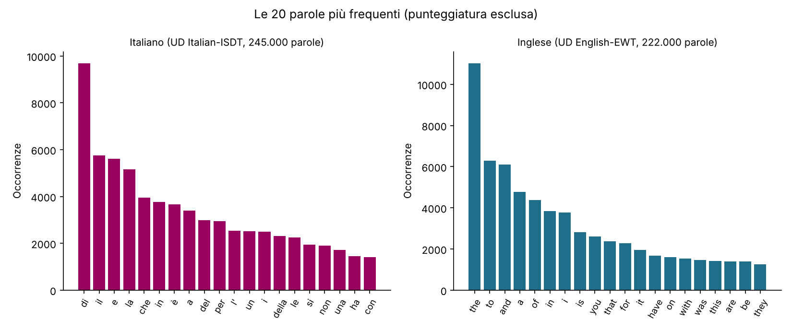
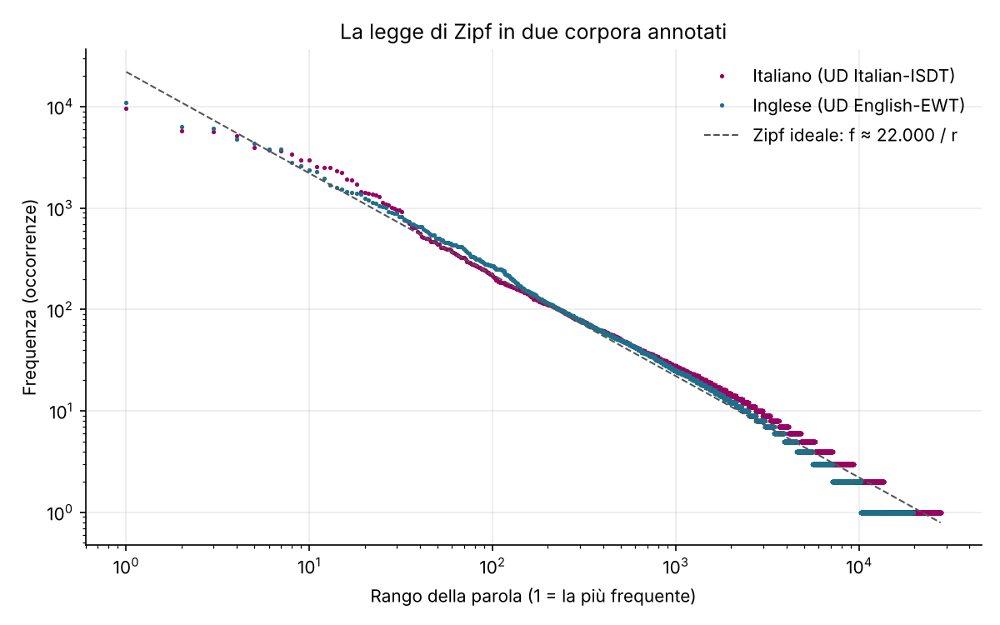
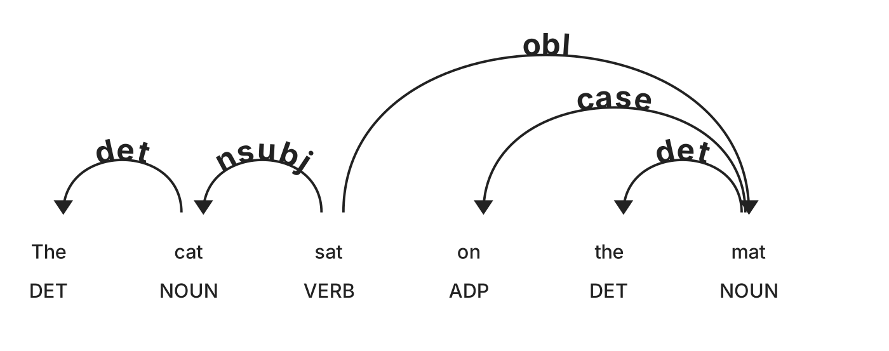
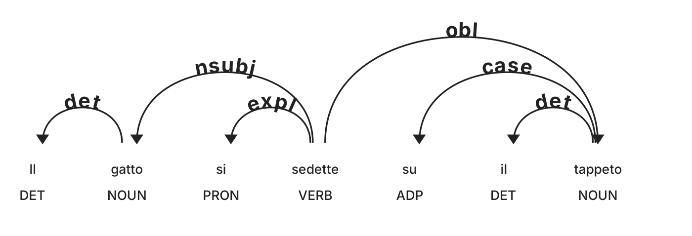
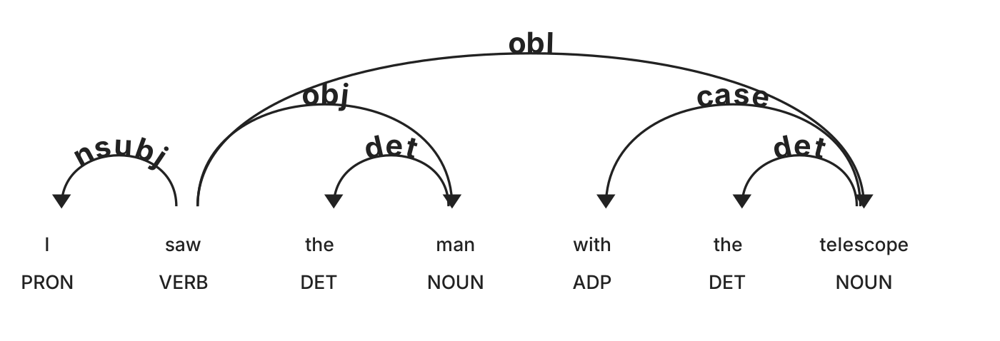
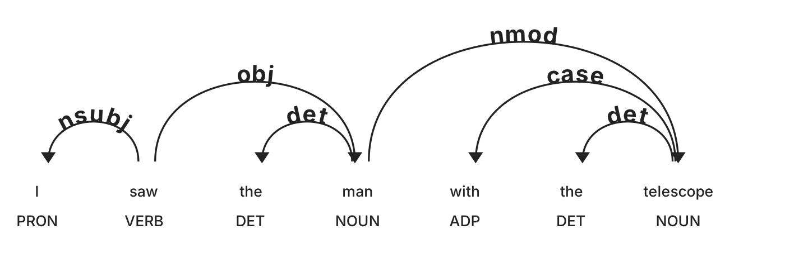
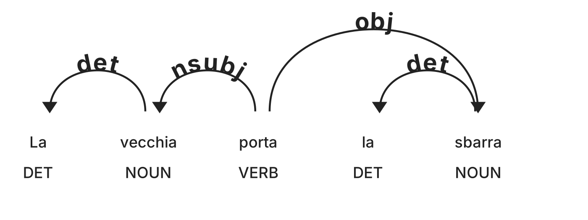
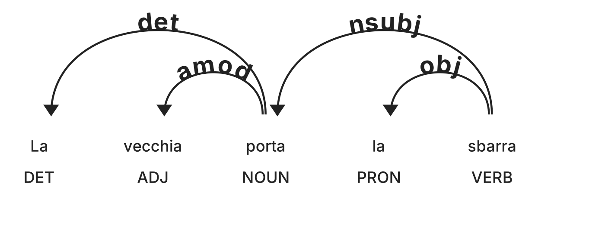

# L09 · Il linguaggio come dato

<p class="meta">Online · 2 ore · Blocco C — Natural Language Processing</p>

!!! abstract "In sintesi"
    Con questa lezione comincia il blocco sul *Natural Language Processing* (NLP), cioè l'elaborazione
    automatica del linguaggio. La domanda di fondo è semplice: che cosa vede una macchina quando "legge"
    un testo? Partiamo dai corpora, che abbiamo incontrato nella L01, e seguiamo il percorso con cui un
    testo diventa un dato: lo si divide in **token**, si riconducono le forme ai **lemmi**, si contano le
    parole e si scopre che le loro frequenze seguono una legge sorprendentemente regolare, la **legge di
    Zipf**. Poi guardiamo i livelli di analisi che una macchina aggiunge al testo (le **parti del
    discorso** e le **dipendenze sintattiche**) e lo schema che li rende confrontabili tra lingue diverse,
    **Universal Dependencies**. Chiudiamo con il problema che attraversa tutto il NLP, l'**ambiguità**, e
    con una guida passo passo a **Voyant Tools** sulle *Avventure di Pinocchio*, in italiano e in inglese.

<div class="slides-embed">
  <iframe src="../../slides/L09.html" title="Slide della lezione 9" loading="lazy" allowfullscreen></iframe>
</div>
<p class="slides-links">
  <a class="md-button" href="../../slides/L09.html" target="_blank" rel="noopener">Slide a schermo intero</a>
  <a class="md-button" href="../../slides/L09.pdf" target="_blank" rel="noopener">Slide in PDF</a>
</p>

## Obiettivi

Alla fine della lezione saprete:

- spiegare che cosa rende un corpus **rappresentativo** e **bilanciato**, e riconoscere i principali
  corpora dell'italiano e dell'inglese;
- descrivere la **tokenizzazione** e i problemi che pone in italiano e in inglese (apostrofi,
  preposizioni articolate, clitici, contrazioni);
- distinguere **type** e **token**, **lemmatizzazione** e **stemming**;
- leggere una lista di frequenza e spiegare che cosa dice la **legge di Zipf**;
- riconoscere **concordanze** e **collocazioni** e sapere a che cosa servono;
- leggere un'annotazione in **parti del discorso** e un **albero a dipendenze** secondo lo schema
  **Universal Dependencies**;
- spiegare perché l'**ambiguità** è il problema centrale del NLP;
- usare le funzioni principali di **Voyant Tools** su un testo letterario.

!!! info "I testi che usiamo"
    Gli esempi su testi letterari usano *Le avventure di Pinocchio* di Carlo Collodi (1883) e la sua
    traduzione inglese di Carol Della Chiesa (*The Adventures of Pinocchio*, 1914). Sono entrambi di
    pubblico dominio e si trovano su Project Gutenberg in formato testo:
    [originale italiano](https://www.gutenberg.org/ebooks/52484.txt.utf-8) e
    [traduzione inglese](https://www.gutenberg.org/ebooks/500.txt.utf-8).
    Per le statistiche usiamo invece due corpora annotati liberamente scaricabili, descritti nella
    sezione 1.

---

## 1. Il corpus

### Da una raccolta di testi a un corpus

Nella L01 abbiamo definito il **corpus** come una raccolta di testi scritti o trascritti dal parlato,
selezionati con criteri espliciti e organizzati per essere analizzati, e abbiamo interrogato DiaCORIS.
Ora possiamo chiederci che cosa distingue un corpus ben costruito da una semplice cartella piena di
file. Le proprietà su cui si insiste di più sono tre.

- **Rappresentatività.** Un corpus serve a dire qualcosa su una lingua o su una sua varietà (l'italiano
  scritto contemporaneo, l'inglese parlato britannico, i testi giuridici). È rappresentativo quando
  include la gamma di variazione presente in quella varietà: generi, registri, autori, periodi. Il
  linguista Douglas Biber (1993) ha mostrato che per ottenerla bisogna prima definire con precisione la
  popolazione di testi che si vuole studiare, e solo dopo decidere come campionarla.
- **Bilanciamento.** Le diverse parti del corpus devono avere proporzioni ragionevoli. Un corpus
  dell'italiano fatto al 90% di articoli di giornale descrive soprattutto la lingua dei giornali.
- **Dimensioni.** Più un fenomeno è raro, più testo serve per osservarlo. Qualche milione di parole basta
  per studiare le parole grammaticali, ma per le collocazioni di una parola poco frequente ne servono
  centinaia di milioni.

A queste si aggiungono i **metadati** (chi ha scritto ciascun testo, quando, in quale genere: è la
tabella di cui abbiamo parlato nella L03) e l'eventuale **annotazione**, cioè le informazioni
linguistiche aggiunte a ogni parola.

### Alcuni corpora dell'italiano e dell'inglese

| Corpus | Lingua | Dimensioni | Che cosa contiene |
|---|---|---|---|
| [**BNC**](https://www.english-corpora.org/bnc/) (*British National Corpus*) | inglese britannico | circa 100 milioni di parole | scritto (90%) e parlato (10%), anni Ottanta e primi Novanta |
| [**COCA**](https://www.english-corpora.org/coca/) (*Corpus of Contemporary American English*) | inglese americano | circa 1 miliardo di parole | parlato televisivo, narrativa, riviste, giornali, testi accademici, web, dal 1990 |
| [**CORIS/CODIS**](https://corpora.ficlit.unibo.it/coris_ita.html) | italiano scritto | circa 165 milioni di parole | stampa, narrativa, saggistica, prosa giuridica e amministrativa, testi effimeri; sviluppato a Bologna |
| [**PAISÀ**](https://www.corpusitaliano.it/) | italiano | circa 250 milioni di parole | testi del web con licenza Creative Commons, annotati |
| [**Google Books Ngram**](https://books.google.com/ngrams/) | molte lingue, tra cui italiano e inglese | centinaia di miliardi di parole | libri digitalizzati da Google, dal Cinquecento a oggi |

I primi quattro sono corpora progettati da linguisti, con criteri di selezione documentati. L'ultimo è
un caso diverso: un'enorme raccolta di libri digitalizzati per altri scopi, utilissima per osservare come
cambia la frequenza di una parola nel tempo, ma con limiti che vedremo nella sezione 3.

!!! example "Per provare"
    Aprite [COCA](https://www.english-corpora.org/coca/) (serve una registrazione gratuita) e cercate
    `make a decision`. La scheda *Context* mostra le occorrenze con anno, genere testuale e fonte; la
    scheda *Frequency* mostra in quali generi l'espressione è più frequente.

### I treebank: corpora annotati fino alla sintassi

Un **treebank** (letteralmente "banca di alberi") è un corpus in cui ogni frase è annotata con la sua
struttura sintattica, oltre che con lemmi e parti del discorso. Costruirlo richiede molto lavoro umano,
e per questo i treebank sono piccoli rispetto ai corpora generali: qualche centinaio di migliaia di
parole. Sono però la base su cui si addestrano e si valutano gli strumenti automatici che vedremo nella
sezione 4.

In questa lezione ne usiamo due, liberamente scaricabili dal progetto Universal Dependencies:

- **UD Italian-ISDT** (*Italian Stanford Dependency Treebank*): circa 14.000 frasi e 245.000 parole,
  tratte da giornali, testi giuridici e Wikipedia;
- **UD English-EWT** (*English Web Treebank*): circa 16.600 frasi e 222.000 parole, tratte da blog,
  gruppi di discussione, email, recensioni e domande e risposte online.

Tenete a mente da dove vengono questi testi: nella sezione 3 vedremo che la composizione di un corpus si
riflette direttamente nei numeri che ne ricaviamo.

---

## 2. Dal testo ai token

### Che cos'è una parola?

Nella L04 abbiamo scritto un programma che contava le parole dell'*Infinito* dividendo il testo in
corrispondenza degli spazi, e abbiamo notato che *quest'ermo* veniva contato come una parola sola. Il
problema è generale. Prima di contare, cercare o analizzare un testo, una macchina deve decidere quali
sono le sue unità, e la nozione intuitiva di "parola" non basta. Il primo passo di quasi ogni
elaborazione si chiama **tokenizzazione**: la divisione di un testo in **token**, cioè le unità minime su
cui lavoreranno gli strumenti successivi. Di solito i token sono parole e segni di punteggiatura.

Dividere sugli spazi e staccare la punteggiatura funziona nella maggior parte dei casi, ma l'italiano e
l'inglese offrono molte eccezioni.

| Fenomeno | Esempio | Quanti token? |
|---|---|---|
| Apostrofo ed elisione | *l'ho*, *dell'anno*, *quest'ermo* | *l'* + *ho*, *dell'* + *anno* |
| Preposizioni articolate | *sul*, *della*, *negli* | una parola scritta, due parole sintattiche (*su* + *il*) |
| Clitici attaccati al verbo | *dammelo*, *portandoglielo*, *ammetterlo* | *da* + *me* + *lo*; *portando* + *glie* + *lo* |
| Contrazioni inglesi | *don't*, *can't*, *I'm* | *do* + *n't*, *ca* + *n't*, *I* + *'m* |
| Genitivo sassone | *Geppetto's house* | *Geppetto* + *'s* |
| Composti e trattini | *New York-based*, *e-mail*, *anglo-americano* | dipende dalle convenzioni |
| Nomi propri di più parole | *New York*, *Grillo Parlante* | due token, ma un solo nome |
| Testo senza spazi | *#nonsonounrobot*, *#throwbackthursday* | per una macchina è un'unica stringa |
| Numeri, date, sigle | *3.000*, *12/03/2026*, *U.S.A.* | il punto chiude la frase oppure no? |

Anche l'apostrofo crea problemi che conosciamo dalla L02: nei testi si trovano sia l'apostrofo
dattilografico `'` (U+0027) sia quello tipografico `’` (U+2019). Per un computer sono due caratteri
diversi, e un tokenizzatore che conosce solo il primo non riconosce *l’ho* come *l'* + *ho*.

### Che cosa fa davvero un tokenizzatore

Vediamo che cosa produce **spaCy**, una libreria di NLP molto usata, con i suoi modelli standard per
l'italiano e per l'inglese (`it_core_news_sm` e `en_core_web_sm`, versione 3.8). Sono risultati reali,
errori compresi.

```text
Dammelo subito: l'ho visto all'ufficio postale, ma non c'è!

Dammelo | subito | : | l' | ho | visto | all' | ufficio | postale | , | ma | non | c' | è | !
```

```text
I don't think New York-based firms can't afford it.

I | do | n't | think | New | York | - | based | firms | ca | n't | afford | it | .
```

Il tokenizzatore inglese segue una convenzione nata con il Penn Treebank negli anni Novanta: *don't*
diventa *do* + *n't* e *can't* diventa *ca* + *n't*, così che la negazione sia sempre lo stesso token.
In italiano gli apostrofi sono gestiti bene, ma *Dammelo* resta un token unico. Nel prossimo paragrafo
vedremo che il modello lo scambia per un nome proprio.

### Type e token

Se contiamo tutte le parole di un testo, contiamo i **token**. Se contiamo quante parole **diverse** ci
sono, contiamo i **type**. Nella frase *la gatta e la volpe* ci sono cinque token e quattro type, perché
*la* compare due volte.

Il rapporto tra type e token (in inglese *type-token ratio*, TTR) misura in modo grezzo la varietà del
lessico di un testo. Nei due treebank di questa lezione:

| | Token | Type (forme diverse) | Lemmi diversi | Type/token |
|---|---|---|---|---|
| Italiano (ISDT) | 244.547 | 27.782 | 18.675 | 0,114 |
| Inglese (EWT) | 221.724 | 19.639 | 15.114 | 0,089 |

*Conteggi fatti da noi sui dati di Universal Dependencies, punteggiatura esclusa, parole convertite in
minuscolo.*

A parità di dimensioni l'italiano ha più type dell'inglese. Il motivo è la morfologia: un verbo italiano
ha decine di forme (*parlo*, *parlavi*, *parlerebbero*, *parlandone*), mentre un verbo inglese ne ha
quattro o cinque (*talk*, *talks*, *talked*, *talking*). Per lo stesso motivo il rapporto tra forme e
lemmi è più alto in italiano (1,49) che in inglese (1,30). Il TTR dipende però dalla lunghezza del
testo, perché più si legge più le parole si ripetono: si possono confrontare solo testi di lunghezza
simile.

### Lemmatizzazione e stemming

Per molte analisi conviene trattare *vado*, *andò* e *andremmo* come la stessa parola. Ci sono due modi
per farlo.

La **lemmatizzazione** riconduce ogni forma al suo **lemma**, la forma di citazione che si trova nel
dizionario (L01): *andò* → *andare*, *went* → *go*, *mice* → *mouse*. Per farlo bene servono un dizionario
morfologico e spesso il contesto: *porta* è il nome *porta* o il verbo *portare*? *saw* è il nome
*saw* (sega) o il passato di *see*?

Lo **stemming** è più rozzo: taglia i suffissi secondo regole fisse e ottiene una "radice" (*stem*) che
non è necessariamente una parola. L'algoritmo più famoso è quello di Martin Porter (1980). Ecco i
risultati reali dello stemmer di Porter per l'inglese e della sua versione per l'italiano (Snowball):

| Parola | Stem | | Parola | Stem |
|---|---|---|---|---|
| *connected*, *connection* | `connect` | | *gatto*, *gatti* | `gatt` |
| *university*, *universe*, *universal* | `univers` | | *parlare*, *parlavano*, *parlamento* | `parl` |
| *organization*, *organ* | `organ` | | *casa*, *caso* | `cas` |
| *ran* | `ran` | | *andare*, *vado*, *andò* | `andar`, `vad`, `andò` |

Lo stemming funziona bene nei casi regolari, ma unisce parole che non hanno niente in comune
(*university* e *universe*, *casa* e *caso*, *parlare* e *parlamento*) e separa forme dello stesso verbo
irregolare. È veloce e non richiede dizionari, e per questo si usa ancora nei motori di ricerca; per lo
studio delle lingue la lemmatizzazione è quasi sempre preferibile.

Anche la lemmatizzazione automatica sbaglia. Ecco i lemmi assegnati dallo stesso modello spaCy per
l'italiano:

| Forma | Lemma assegnato | Lemma corretto |
|---|---|---|
| *sedette* | `sedettere` | *sedere* |
| *mangiarono* | `mangiarere` | *mangiare* |
| *Dammelo* | `Dammelo` (nome proprio) | *dare* + *me* + *lo* |
| *all'* | `a il` | *a* + *il* |

Gli errori sui passati remoti si spiegano con i dati di addestramento: un modello che ha visto pochi
passati remoti in testi giornalistici prova a costruire un infinito per analogia e inventa una parola.
È una buona ragione per guardare sempre un campione dei risultati prima di fidarsi dei conteggi.

---

## 3. Contare

### Le liste di frequenza

Una volta tokenizzato il testo, contare è facile: è il programma con il **dizionario** della L04. Il
risultato è una **lista di frequenza**, cioè l'elenco dei type ordinati dal più al meno frequente. Ecco le
venti parole più frequenti nei nostri due treebank.

<figure markdown>
{ width="820" loading=lazy }
<figcaption>Le venti forme più frequenti in UD Italian-ISDT e in UD English-EWT, punteggiatura esclusa.
Elaborazione nostra sui dati di Universal Dependencies.</figcaption>
</figure>

In cima alle liste ci sono solo **parole grammaticali**: articoli, preposizioni, congiunzioni, pronomi,
ausiliari. In molte analisi queste parole si escludono con una lista di **stopword** ("parole vuote"),
così da far emergere le parole che dicono qualcosa sul contenuto. L'esclusione però è una scelta, e
dipende dalla domanda: chi studia lo stile di un autore o l'uso dei pronomi ha bisogno proprio delle
parole che le stopword eliminano.

Più in basso nelle liste si vede la composizione dei corpora. Nel treebank italiano il centesimo posto
è occupato da *proprietario*, una parola che deve la sua frequenza ai testi giuridici; nel treebank
inglese, fatto di testi del web, *I* e *you* sono tra le prime dieci parole e al centesimo posto c'è
*thanks*. Il corpus decide che cosa vedremo.

### La legge di Zipf

Negli anni Trenta e Quaranta il linguista statunitense George Kingsley Zipf osservò una regolarità che
vale per tutte le lingue studiate finora: se si ordinano le parole per frequenza, la frequenza di una
parola è circa **inversamente proporzionale** alla sua posizione in classifica (il **rango**). La seconda
parola compare circa la metà delle volte della prima, la terza circa un terzo, la decima circa un
decimo, e così via. In formula, con *f* la frequenza e *r* il rango:

<p style="text-align:center"><em>f</em> ≈ <em>C</em> / <em>r</em></p>

dove *C* è una costante che dipende dalle dimensioni del corpus. Nei nostri dati *di* compare 9.695
volte e *il*, seconda, 5.756; in inglese *the* compare 11.028 volte e *to* 6.294. Non è una legge esatta,
ma l'andamento generale è sorprendentemente stabile. Si vede bene in un grafico con le scale
**logaritmiche**, in cui ogni tacca vale dieci volte la precedente: la relazione di Zipf diventa una
linea retta.

<figure markdown>
{ width="720" loading=lazy }
<figcaption>Rango e frequenza di tutte le forme dei due treebank, su scale logaritmiche. I punti seguono
da vicino una retta, come prevede la legge di Zipf (linea tratteggiata). Elaborazione nostra sui dati di
Universal Dependencies.</figcaption>
</figure>

Le conseguenze pratiche sono importanti per chiunque lavori con i testi:

- **poche parole fanno la maggior parte del testo**: nel treebank italiano le 100 forme più frequenti
  coprono il 43% di tutti i token, in quello inglese il 47%;
- **la maggior parte delle parole è rara**: circa metà dei type compare **una volta sola** (il 51% in
  italiano, il 48% in inglese). Queste parole si chiamano ***hapax legomena*** (dal greco, "dette una
  volta sola");
- **nessun corpus è abbastanza grande**: per quanto si allarghi un corpus, si continueranno a incontrare
  parole mai viste prima. È un problema per chi costruisce dizionari, per chi studia le parole rare e,
  come vedremo nella L13, anche per i modelli linguistici.

Le ragioni della legge di Zipf sono ancora discusse. Zipf la attribuiva a un "principio del minimo
sforzo" nella comunicazione; altri studiosi l'hanno spiegata in modi diversi, e una rassegna del 2014
(Piantadosi) conclude che nessuna spiegazione è ancora davvero convincente.

### Concordanze

La **concordanza** l'abbiamo vista nella L01: tutte le occorrenze di una parola, ciascuna con il suo
contesto a sinistra e a destra, allineate al centro. Il formato si chiama **KWIC** (*Key Word In
Context*). Ecco alcune righe reali per il verbo *make* nel treebank inglese:

```text
            some reliable bearded guides to |  make  | sure you have everything set
                       I will come over and |  make  | the change at your desk
                      Any tips or advice to |  make  | this a great experience ??
                                     How to |  make  | a breyer horse stable ?
                     The outward appearance | makes  | you think this place is
                 the Enron guaranties to be |  made  | in support of EPMI 's
                    to hear the same leader | making | opposite statements in Arabic to
```

Le concordanze hanno una storia lunga: le prime, compilate a mano sulla Bibbia, risalgono al Duecento.
Con il computer è cambiata soprattutto la scala. Leggere le righe di una concordanza resta il modo
migliore per capire come si usa una parola, ed è utile anche per chi traduce: una concordanza mostra le
costruzioni in cui una parola compare davvero, che spesso il dizionario non registra.

!!! example "Per provare"
    In [CORIS](https://corpora.ficlit.unibo.it/coris_ita.html) cercate `"battente"` e leggete le righe di
    concordanza: con quali nomi compare?

### Collocazioni

Alcune parole stanno insieme più spesso di quanto ci si aspetterebbe per caso. In inglese si dice *strong
tea* e non *powerful tea*, anche se *strong* e *powerful* hanno significati vicini; in italiano la
pioggia è *battente* e non *picchiante*, e una decisione in italiano si *prende*, mentre in inglese si
*fa* (*make a decision*). Queste
combinazioni preferite si chiamano **collocazioni**, e sono uno dei punti più difficili per chi impara
una lingua e per chi traduce.

Nel treebank inglese, per esempio, il verbo *make* si accompagna a *decision*, *sense* e *change*, mentre
*do* si accompagna a *job*, *work* e *research*.

Un corpus permette di trovare le collocazioni in modo sistematico. Gli strumenti confrontano quante
volte due parole compaiono vicine con quante volte ci si aspetterebbe di trovarle vicine se fossero
distribuite a caso, e assegnano un **punteggio di associazione**. Le misure più usate hanno nomi tecnici
(*mutual information*, *log-likelihood*, *logDice*); non serve conoscerne le formule, basta sapere che
misurano la forza del legame e che misure diverse danno classifiche un po' diverse: alcune premiano le
combinazioni rare ed esclusive, altre quelle frequenti.

!!! example "Per provare"
    In [COCA](https://www.english-corpora.org/coca/) scegliete la ricerca *Collocates*, scrivete `tea` e
    limitate i collocati alle parole immediatamente a sinistra: in cima troverete gli aggettivi che si
    combinano con *tea*, ordinati per punteggio di associazione.

L'idea che le parole si conoscano dalle loro compagnie è stata riassunta dal linguista britannico John
Rupert Firth nel 1957 con una frase molto citata: *"You shall know a word by the company it keeps"*.
Ci tornerà utile nella L10, quando vedremo come le macchine rappresentano il significato delle parole a
partire dai contesti in cui compaiono.

### Le frequenze nel tempo: Google Books Ngram Viewer

Il [Google Books Ngram Viewer](https://books.google.com/ngrams/) mostra come cambia nel tempo la frequenza
di una parola o di una sequenza di parole (un ***n*-gramma**: un unigramma è una parola, un bigramma una
sequenza di due, e così via) nei libri digitalizzati da Google. Si possono confrontare più espressioni e
scegliere il corpus di una lingua, tra cui l'italiano e l'inglese.

!!! example "Per provare"
    Nel [Ngram Viewer](https://books.google.com/ngrams/) scrivete `calcolatore,computer`, scegliete il
    corpus *Italian* e l'intervallo 1940–2022. In che decennio *computer* supera *calcolatore*?

Lo strumento è affascinante, ma i suoi dati vanno presi con cautela. Pechenick, Danforth e Dodds (2015)
hanno mostrato due problemi importanti: il corpus contiene **una copia di ogni libro**, quindi un autore
molto prolifico pesa quanto un autore letto da milioni di persone; e nel corso del Novecento la quota di
**testi scientifici** cresce enormemente, così che molte "tendenze" riflettono il cambiamento della
composizione del corpus più che quello della lingua. È lo stesso problema della rappresentatività da cui
siamo partiti.

---

## 4. I livelli di analisi

### Le parti del discorso

Dopo la tokenizzazione e la lemmatizzazione, il passo successivo è assegnare a ogni token la sua
**parte del discorso** (in inglese *part of speech*, PoS): nome, verbo, aggettivo e così via. Il compito
si chiama ***PoS tagging***, e le etichette si chiamano *tag*.

Per decenni ogni gruppo di ricerca ha usato il proprio insieme di etichette. Il più famoso è quello del
**Penn Treebank** per l'inglese, con 36 etichette per le parole: distingue, per esempio, `NN` (nome
singolare), `NNS` (nome plurale), `VBD` (verbo al passato), `VBG` (gerundio o participio presente). È un
insieme pensato per l'inglese, e non si adatta bene alle altre lingue.

Il progetto **Universal Dependencies** (UD) usa invece un insieme di **17 etichette universali**, le
stesse per tutte le lingue:

| Tag | Categoria | Esempi |
|---|---|---|
| `NOUN` | nome | *burattino*, *puppet* |
| `PROPN` | nome proprio | *Geppetto*, *Florence* |
| `VERB` | verbo | *scappò*, *ran* |
| `AUX` | ausiliare | *ha*, *è*, *has*, *will* |
| `ADJ` | aggettivo | *vecchio*, *wooden* |
| `ADV` | avverbio | *subito*, *quickly* |
| `PRON` | pronome | *lui*, *lo*, *she*, *it* |
| `DET` | determinante | *il*, *questa*, *the*, *every* |
| `ADP` | adposizione (preposizione) | *di*, *con*, *of*, *with* |
| `CCONJ` / `SCONJ` | congiunzione coordinante / subordinante | *e*, *ma* / *perché*, *if* |
| `NUM` | numerale | *cinque*, *1883* |
| `PART` | particella | *not*, il *to* di *to go* |
| `INTJ` | interiezione | *ahi*, *oh* |
| `PUNCT` / `SYM` / `X` | punteggiatura / simbolo / altro | *.*, *%*, parole straniere |

Le informazioni più fini (genere, numero, tempo, modo, persona) non finiscono nel tag ma in un campo
separato di **tratti morfologici**, per esempio `Gender=Fem|Number=Plur` per *ragazze*.

!!! warning "Una correzione rispetto ai materiali degli anni passati"
    Nelle slide degli anni scorsi la frase *Il gatto si sedette sul tappeto* era etichettata con i tag
    del Penn Treebank (`DT`, `NN`, `VBD`, `IN`), che sono pensati per l'inglese, e *si sedette* era
    trattato come un token unico. Secondo le convenzioni attuali *si* e *sedette* sono due token
    (`PRON` e `VERB`) e *sul* corrisponde a due parole sintattiche, *su* (`ADP`) e *il* (`DET`). Nello
    stesso materiale l'esempio di tokenizzazione di *Sto bene!* contava anche lo spazio come token: gli
    spazi separano i token, ma non lo sono.

### Il formato CoNLL-U

I treebank di Universal Dependencies sono semplici file di testo in un formato chiamato **CoNLL-U**: una
riga per parola, dieci colonne separate da tabulazioni, una riga vuota tra una frase e l'altra. Ecco una
frase reale di UD Italian-ISDT, con le colonne principali:

```text
# text = Ma noi non vogliamo ammetterlo.
ID    FORMA       LEMMA      UPOS    TESTA  RELAZIONE
1     Ma          ma         CCONJ   5      cc
2     noi         noi        PRON    5      nsubj
3     non         non        ADV     5      advmod
4     vogliamo    volere     AUX     5      aux
5-6   ammetterlo  _          _       _      _
5     ammetter    ammettere  VERB    0      root
6     lo          lo         PRON    5      obj
7     .           .          PUNCT   5      punct
```

È una **tabella** (L03), e ogni riga è un piccolo insieme di coppie attributo-valore. Notate la riga
`5-6`: la parola scritta *ammetterlo* viene divisa in due parole sintattiche, il verbo *ammetter(e)* e il
clitico *lo*. Lo stesso accade per le preposizioni articolate (*della* = *di* + *la*). È la soluzione di
UD al problema dei clitici visto nella sezione 2.

### L'analisi a dipendenze

Le ultime due colonne, **testa** e **relazione**, descrivono la sintassi. Nell'**analisi a dipendenze**
ogni parola dipende da un'altra parola, la sua **testa**, e la relazione tra le due ha un nome. Il verbo
principale non dipende da nessuno ed è la **radice** (`root`) della frase. Il risultato è un **albero**,
la struttura dati della L03.

Ecco la stessa frase in inglese e in italiano, analizzata secondo UD.

<figure markdown>
{ width="620" loading=lazy }
</figure>

<figure markdown>
{ width="700" loading=lazy }
<figcaption>Le due frasi analizzate secondo lo schema UD. Ogni freccia va dalla testa alla parola che
ne dipende; sotto ogni parola c'è la sua parte del discorso.</figcaption>
</figure>

Le relazioni da conoscere sono poche:

| Relazione | Significato | Esempio (parola dipendente → testa) |
|---|---|---|
| `nsubj` | soggetto | *cat* → *sat*, *gatto* → *sedette* |
| `obj` | oggetto diretto | *lo* → *ammetter* nella frase precedente |
| `obl` | complemento introdotto da preposizione, che dipende dal verbo | *mat* → *sat*, *tappeto* → *sedette* |
| `nmod` | complemento che dipende da un nome | *di Pinocchio* → *naso* in *il naso di Pinocchio* |
| `det` | determinante | *the* → *cat*, *il* → *gatto* |
| `amod` | aggettivo che modifica un nome | *vecchio* → *falegname* |
| `case` | preposizione o marca di caso | *on* → *mat*, *su* → *tappeto* |
| `aux` | ausiliare | *vogliamo* → *ammetter* |
| `expl` | pronome che non ha un ruolo argomentale | *si* in *si sedette* |

Confrontate i due alberi: la struttura è la stessa. In entrambe le lingue la preposizione dipende dal
nome (`case`) e il nome dipende dal verbo (`obl`). L'italiano ha in più il *si* del verbo pronominale,
etichettato `expl`. Questa è l'idea di fondo di UD: annotare le lingue in modo **coerente**, così che le
somiglianze siano visibili e le differenze reali (de Marneffe et al., 2021). Universal Dependencies
comprende oggi treebank per più di 150 lingue, costruiti da centinaia di ricercatori.

### Provare un parser online: UDPipe

Un programma che produce automaticamente l'analisi a dipendenze si chiama **parser**. Uno dei più comodi
da provare è [**UDPipe**](https://lindat.mff.cuni.cz/services/udpipe/), sviluppato all'Università Carlo di
Praga: si sceglie il modello di una lingua, si incolla un testo e si ottiene l'analisi completa, sia come
tabella CoNLL-U sia come albero disegnato.

!!! example "Per provare"
    Su [UDPipe](https://lindat.mff.cuni.cz/services/udpipe/) scegliete il modello `italian-isdt`,
    incollate `Ma noi non vogliamo ammetterlo.` e premete *Process input*. Nella scheda *Show table*
    trovate il formato CoNLL-U, nella scheda *Show trees* l'albero.

---

## 5. L'ambiguità

Tutti i passaggi visti finora richiedono una scelta, e quasi ogni scelta può essere ambigua. Per una
persona l'ambiguità di solito passa inosservata, perché il contesto e la conoscenza del mondo eliminano
le letture assurde prima ancora che ce ne accorgiamo. Una macchina invece deve scegliere esplicitamente,
e spesso non ha le informazioni per farlo. Per questo l'ambiguità è considerata il problema centrale
del NLP.

### Ambiguità lessicale e morfologica

Una stessa forma può corrispondere a parole diverse: *porta* (nome o verbo), *pesca* (frutto, sport,
verbo), *saw* (sega o passato di *see*), *bank* (banca o riva). Il classico esempio inglese mostra come
l'ambiguità lessicale si combini con quella sintattica:

> *Time flies like an arrow; fruit flies like a banana.*

Nella prima frase *flies* è un verbo e *like* una preposizione ("il tempo vola come una freccia");
nella seconda *fruit flies* è un nome composto (i moscerini della frutta) e *like* un verbo ("ai
moscerini piacciono le banane"). Il modello spaCy per l'inglese analizza le due frasi **nello stesso
modo**, con *flies* verbo e *like* preposizione: la seconda frase diventa "la frutta vola come una
banana".

### Ambiguità sintattica

Anche quando le parole sono chiare, la struttura può non esserlo:

> *I saw the man with the telescope.*

Chi ha il cannocchiale? Se l'ho usato io per vedere, *telescope* dipende dal verbo (`obl`); se ce l'ha
l'uomo, dipende da *man* (`nmod`). Sono due alberi diversi.

<figure markdown>
{ width="680" loading=lazy }
</figure>

<figure markdown>
{ width="680" loading=lazy }
<figcaption>Le due analisi di <em>I saw the man with the telescope</em>. Cambia soltanto la testa di
<em>telescope</em>: <em>saw</em> nella prima, <em>man</em> nella seconda.</figcaption>
</figure>

Il parser sceglie una sola delle due letture (spaCy sceglie la seconda, sia in inglese sia nella frase
italiana *Ho visto un uomo con il binocolo*) e non segnala che ne esisteva un'altra.

Un esempio italiano famoso è ancora più radicale:

> *La vecchia porta la sbarra.*

Si può leggere come "la donna anziana porta la sbarra" oppure come "la porta vecchia la sbarra", cioè le
sbarra il passaggio. Cambiano le parti del discorso di quattro parole su cinque.

<figure markdown>
{ width="560" loading=lazy }
</figure>

<figure markdown>
{ width="560" loading=lazy }
<figcaption>Le due letture: nella prima <em>vecchia</em> è un nome e <em>porta</em> un verbo; nella
seconda <em>vecchia</em> è un aggettivo, <em>porta</em> un nome, <em>la</em> un pronome e
<em>sbarra</em> un verbo.</figcaption>
</figure>

Il modello spaCy per l'italiano non sceglie nessuna delle due: tagga *vecchia* come aggettivo, *porta*
come nome e *sbarra* come nome, e costruisce una frase senza verbo. È un risultato che nessun parlante
darebbe, e mostra bene come lavora lo strumento: sceglie l'analisi più probabile sulla base dei testi
che ha visto durante l'addestramento, senza alcuna idea di che cosa succede nella scena descritta.

### Frasi che portano fuori strada

Alcune frasi portano fuori strada anche il lettore umano. In inglese si chiamano *garden path
sentences*, dall'espressione *to lead someone up the garden path*, "portare qualcuno fuori strada". In *The old man the boat* si legge istintivamente *the old man* come "il vecchio",
e la frase sembra senza verbo; poi si capisce che *the old* significa "gli anziani" e *man* è un verbo
("gli anziani formano l'equipaggio della barca"). Una macchina che analizza la frase da sinistra a destra
cade nella stessa trappola.

### Altri tipi di ambiguità

L'ambiguità non finisce con la sintassi. C'è quella **referenziale** (in *Geppetto disse a Pinocchio che
lui sarebbe tornato presto*, chi tornerà?), quella di **ambito** (*every student read a book*: lo stesso
libro per tutti?) e quella **pragmatica** (*Puoi aprire la finestra?* è una domanda sulle capacità o una
richiesta?). Ne riparleremo a proposito della traduzione automatica nella L10 e dei modelli linguistici
nella L13.

---

## 6. Voyant Tools, passo passo

[**Voyant Tools**](https://voyant-tools.org/) è un ambiente di analisi testuale gratuito che funziona nel
browser, senza installare nulla. È stato sviluppato da Stéfan Sinclair e Geoffrey Rockwell ed è molto
usato nelle Digital Humanities. Mette insieme in una sola pagina quasi tutto quello che abbiamo visto in
questa lezione: tokenizzazione, liste di frequenza, stopword, concordanze, collocazioni. Lo proviamo sulle
*Avventure di Pinocchio* in italiano e in inglese.

### Caricare i testi

Nella pagina iniziale si può incollare un testo, caricare un file dal computer oppure scrivere uno o più
indirizzi web, uno per riga. Incollate i due indirizzi di Project Gutenberg indicati all'inizio della
lezione e premete **Reveal**. Voyant crea un **corpus** di due documenti.

!!! tip "Un dettaglio da non trascurare"
    I file di Project Gutenberg contengono all'inizio e alla fine un'intestazione e una licenza in
    inglese, che finiscono nei conteggi. Per un'analisi seria conviene scaricare i file, eliminare queste
    parti e caricare i file puliti. È un esempio concreto di **preparazione dei dati**, il lavoro poco
    visibile che precede ogni analisi.

### Il cruscotto

Voyant mostra cinque pannelli: **Cirrus** (una nuvola di parole), **Reader** (il testo), **Trends** (la
distribuzione delle parole nel testo), **Summary** (un riassunto statistico) e **Contexts** (la
concordanza). Ogni pannello ha in alto alcune icone: passandoci sopra il mouse si possono sostituire con
altri strumenti, esportare i dati o aprire le impostazioni.

### Summary: le statistiche del corpus

Il pannello **Summary** riporta per ogni documento il numero di token (*words*) e di type (*unique word
forms*), il rapporto tra i due (*vocabulary density*), la lunghezza media delle frasi e le parole più
caratteristiche di ciascun documento rispetto all'altro (*distinctive words*). Confrontare originale e
traduzione è istruttivo: quale dei due testi è più lungo? Quale ha un lessico più vario?

### Cirrus e le stopword

La nuvola di parole mostra le parole più frequenti, con dimensioni proporzionali alla frequenza. Voyant
riconosce la lingua e applica automaticamente una lista di stopword. Dalle impostazioni del pannello
(l'icona con i cursori) si può cambiare la lista o disattivarla: provate a confrontare le due nuvole e
ritroverete in cima *di*, *e*, *il*, *the*, *and*, come nelle liste della sezione 3.

Le nuvole di parole sono immediate ma imprecise: la dimensione delle parole è difficile da confrontare a
occhio e la disposizione non significa nulla. Per i numeri veri conviene usare la tabella **Terms**, che
si apre dalle icone del pannello Cirrus e riporta la frequenza assoluta e relativa di ogni parola.

### Trends: dove compare una parola

Il pannello **Trends** divide ogni documento in segmenti e mostra la frequenza di una o più parole in
ciascun segmento. Scrivendo nella casella di ricerca *fata*, *grillo* e *volpe* si vede in quali parti
del romanzo compaiono questi personaggi. Nel testo inglese si possono cercare *fairy*, *cricket* e
*fox*.

### Contexts e Collocates

Il pannello **Contexts** è la concordanza: cliccando su una parola in qualsiasi altro pannello, Contexts
mostra tutte le sue occorrenze con il contesto. Il pannello **Collocates** (da aggiungere con l'icona
delle finestre) elenca le parole che compaiono più spesso vicino alla parola scelta. Provate con *naso* e
con *nose*: quali verbi e aggettivi lo accompagnano in italiano e in inglese?

!!! warning "Che cosa Voyant non fa"
    Voyant lavora sulle **forme**, non sui lemmi, e non riconosce le parti del discorso. *Burattino* e
    *burattini* sono due parole diverse, e *porta* è sempre la stessa parola che sia un nome o un verbo.
    Per analisi linguistiche più fini servono corpora annotati e strumenti come Sketch Engine, che
    vedremo nella L11.

---

## Chi entra in un corpus

Ogni corpus è una selezione, e ogni selezione lascia fuori qualcosa. Nei corpora generali l'italiano è
soprattutto quello scritto, e soprattutto quello dei giornali; il parlato, gli italiani regionali e i
dialetti sono molto meno rappresentati, perché raccoglierli e trascriverli costa di più. I due treebank di
questa lezione mostrano lo stesso fenomeno in piccolo: il nostro "italiano" è quello dei giornali e delle
leggi, il nostro "inglese" quello dei forum e delle recensioni online.

Le conseguenze vanno oltre la linguistica. Gli strumenti automatici imparano dai corpora annotati: un
lemmatizzatore che ha visto pochi passati remoti li sbaglia, un parser addestrato su testi giornalistici
funziona peggio su un messaggio WhatsApp o su una trascrizione del parlato. E poiché costruire un treebank
richiede anni di lavoro, le lingue con più risorse (l'inglese prima di tutte) hanno anche gli strumenti
migliori. Ne parleremo più a fondo nella L11.

---

## Riepilogo

| Concetto | In una frase |
|---|---|
| Corpus | Raccolta di testi selezionati con criteri espliciti: rappresentativa, bilanciata, documentata |
| Treebank | Corpus annotato anche con la struttura sintattica di ogni frase |
| Tokenizzazione | Divisione del testo in unità minime (token): più difficile di quanto sembri |
| Type e token | Parole diverse e parole totali; il loro rapporto misura la varietà del lessico |
| Lemmatizzazione / stemming | Ricondurre le forme al lemma del dizionario / tagliare i suffissi con regole fisse |
| Stopword | Parole grammaticali che si escludono da alcune analisi, per scelta |
| Legge di Zipf | La frequenza di una parola è circa inversamente proporzionale al suo rango |
| Hapax | Parola che compare una sola volta; circa metà dei type di un corpus |
| Concordanza (KWIC) | Tutte le occorrenze di una parola con il contesto, allineate al centro |
| Collocazione | Combinazione di parole più frequente di quanto ci si aspetterebbe per caso |
| PoS tagging | Assegnare a ogni token la sua parte del discorso |
| Analisi a dipendenze | Ogni parola dipende da una testa, con una relazione: il risultato è un albero |
| Universal Dependencies | Uno schema di annotazione comune per più di 150 lingue |
| Ambiguità | Più analisi possibili per la stessa forma o frase: il problema centrale del NLP |

---

## Attività

**A casa (facoltativo)**

1. **Pinocchio in Voyant.** Caricate in Voyant i due testi di Pinocchio, come descritto nella sezione 6.
   Nel pannello Summary confrontate il numero di token e di type dei due documenti: quale testo è più
   lungo? Quale ha il lessico più vario? Provate a spiegare perché, ricordando che cosa abbiamo detto
   sulla morfologia dell'italiano e dell'inglese.
2. **Personaggi nel tempo.** Nel pannello Trends confrontate la distribuzione di *Geppetto* e di
   *Lucignolo* nel testo italiano. Che cosa vi dice il grafico sulla struttura del romanzo?
3. **Un albero tutto vostro.** Aprite [UDPipe](https://lindat.mff.cuni.cz/services/udpipe/), scegliete il
   modello italiano o inglese e analizzate una frase che vi sembra difficile: con clitici, con una
   preposizione ambigua, con un verbo che può essere anche un nome. Nella scheda *Show trees* controllate
   l'albero: il parser ha scelto la lettura giusta?
4. **Collocazioni a confronto.** Su [COCA](https://www.english-corpora.org/coca/) (serve una registrazione
   gratuita) cercate i collocati di *decision*. Quali verbi lo precedono? Confrontate con le espressioni
   italiane che usereste per tradurli.

---

## Mettetevi alla prova

**1.** Quale di queste caratteristiche **non** è tra quelle che rendono un corpus ben progettato?

- A. La rappresentatività rispetto alla varietà di lingua che si vuole studiare
- B. Il bilanciamento tra le diverse parti
- C. La presenza di testi tutti dello stesso autore
- D. La documentazione dei criteri di selezione e dei metadati

??? success "Soluzione"
    **C.** Un corpus di un solo autore può servire per studiare quell'autore, ma non rappresenta una
    lingua o una varietà.

**2.** Nella frase *il gatto vide il cane e il cane vide il gatto*, quanti sono i token e quanti i type
(senza contare la punteggiatura)?

- A. 11 token, 11 type
- B. 11 token, 5 type
- C. 5 token, 11 type
- D. 11 token, 4 type

??? success "Soluzione"
    **B.** Le parole sono undici in tutto; quelle diverse sono cinque: *il*, *gatto*, *vide*, *cane*, *e*.

**3.** Un programma riconduce *university* e *universe* alla stessa forma `univers`. Che cosa sta
facendo?

- A. Lemmatizzazione
- B. Stemming
- C. PoS tagging
- D. Tokenizzazione

??? success "Soluzione"
    **B.** Lo stemming taglia i suffissi con regole fisse e per questo unisce parole che non hanno
    niente in comune. Un lemmatizzatore restituirebbe due lemmi diversi.

**4.** In un corpus di un milione di parole, la parola più frequente compare 60.000 volte. Secondo la
legge di Zipf, circa quante volte comparirà la terza parola più frequente?

- A. 57.000
- B. 30.000
- C. 20.000
- D. 6.000

??? success "Soluzione"
    **C.** La frequenza è circa inversamente proporzionale al rango: la terza parola compare circa un
    terzo delle volte della prima.

**5.** Che cosa sono gli *hapax legomena*?

- A. Le parole grammaticali escluse dalle analisi
- B. Le parole che compaiono una sola volta in un corpus
- C. Le parole più frequenti di un corpus
- D. Le parole composte da più token

??? success "Soluzione"
    **B.** Sono circa metà dei type di un corpus, come prevede la legge di Zipf.

**6.** In inglese si dice *strong tea* e non *powerful tea*. Come si chiama questo fenomeno?

- A. Ambiguità lessicale
- B. Collocazione
- C. Lemmatizzazione
- D. Concordanza

??? success "Soluzione"
    **B.** Una collocazione è una combinazione di parole preferita dall'uso, più frequente di quanto ci si
    aspetterebbe per caso.

**7.** Nell'annotazione Universal Dependencies della frase *Il gatto dorme sul divano*, quale
relazione lega *gatto* a *dorme*?

- A. `obj`
- B. `nsubj`
- C. `det`
- D. `case`

??? success "Soluzione"
    **B.** *Gatto* è il soggetto del verbo. `det` lega *il* a *gatto*, `case` lega *su* a *divano*.

**8.** Perché la frase *I saw the man with the telescope* è difficile per un parser?

- A. Perché contiene una parola che il parser non conosce
- B. Perché *with the telescope* può dipendere sia dal verbo sia dal nome, e le due analisi sono
  entrambe grammaticali
- C. Perché è troppo lunga
- D. Perché in inglese le preposizioni non hanno un tag universale

??? success "Soluzione"
    **B.** È un caso di ambiguità sintattica: due alberi diversi, entrambi corretti, tra cui solo il
    contesto permette di scegliere.

---

## Per approfondire

- Biber, D. (1993). Representativeness in corpus design. *Literary and Linguistic Computing*, *8*(4),
  243–257. [doi:10.1093/llc/8.4.243](https://doi.org/10.1093/llc/8.4.243)
- Davies, M. (2010). The Corpus of Contemporary American English as the first reliable monitor corpus of
  English. *Literary and Linguistic Computing*, *25*(4), 447–464.
  [doi:10.1093/llc/fqq018](https://doi.org/10.1093/llc/fqq018)
- Tamburini, F. (2022). I corpora del FICLIT, Università di Bologna: CORIS/CODIS, BoLC e DiaCORIS. In
  *Atti del LIV Congresso della Società di Linguistica Italiana*. Società di Linguistica Italiana.
  [doi:10.17469/O2106SLI000012](https://doi.org/10.17469/O2106SLI000012)
- Lyding, V., Stemle, E., Borghetti, C., Brunello, M., Castagnoli, S., Dell'Orletta, F., Dittmann, H.,
  Lenci, A., & Pirrelli, V. (2014). The PAISÀ corpus of Italian web texts. In *Proceedings of the 9th Web
  as Corpus Workshop (WaC-9)* (pp. 36–43). [doi:10.3115/v1/W14-0406](https://doi.org/10.3115/v1/W14-0406)
- Piantadosi, S. T. (2014). Zipf's word frequency law in natural language: A critical review and future
  directions. *Psychonomic Bulletin & Review*, *21*(5), 1112–1130.
  [doi:10.3758/s13423-014-0585-6](https://doi.org/10.3758/s13423-014-0585-6)
- Pechenick, E. A., Danforth, C. M., & Dodds, P. S. (2015). Characterizing the Google Books corpus: Strong
  limits to inferences of socio-cultural and linguistic evolution. *PLoS ONE*, *10*(10), e0137041.
  [doi:10.1371/journal.pone.0137041](https://doi.org/10.1371/journal.pone.0137041)
- de Marneffe, M.-C., Manning, C. D., Nivre, J., & Zeman, D. (2021). Universal Dependencies.
  *Computational Linguistics*, *47*(2), 255–308. [doi:10.1162/coli_a_00402](https://doi.org/10.1162/coli_a_00402)
- Porter, M. F. (1980). An algorithm for suffix stripping. *Program*, *14*(3), 130–137.
  [doi:10.1108/eb046814](https://doi.org/10.1108/eb046814)
- Jurafsky, D., & Martin, J. H. [*Speech and Language Processing*](https://web.stanford.edu/~jurafsky/slp3/)
  (3ª ed., bozza online), capitolo 2 (parole, token, normalizzazione) e capitoli sul PoS tagging e
  sull'analisi a dipendenze.
- [Universal Dependencies](https://universaldependencies.org/): la documentazione dei tag e delle
  relazioni, con esempi in tutte le lingue.
- [Voyant Tools: documentazione](https://voyant-tools.org/docs/), in inglese.

Elenco completo in [Letture e materiali](../letture.md#blocco-c-natural-language-processing).

## Parole chiave

[Corpus](../glossario.md#corpus) ·
[Treebank](../glossario.md#treebank) ·
[Token](../glossario.md#token) ·
[Tokenizzazione](../glossario.md#tokenizzazione) ·
[Type e token](../glossario.md#type-e-token) ·
[Lemma](../glossario.md#lemma) ·
[Stemming](../glossario.md#stemming) ·
[Stopword](../glossario.md#stopword) ·
[Legge di Zipf](../glossario.md#legge-di-zipf) ·
[Hapax](../glossario.md#hapax) ·
[Concordanza](../glossario.md#concordanza) ·
[Collocazione](../glossario.md#collocazione) ·
[n-gramma](../glossario.md#n-gramma) ·
[PoS tagging](../glossario.md#pos-tagging) ·
[Analisi a dipendenze](../glossario.md#analisi-a-dipendenze) ·
[Universal Dependencies](../glossario.md#universal-dependencies) ·
[Ambiguità](../glossario.md#ambiguita)
