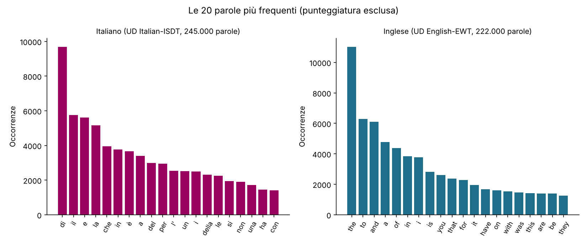
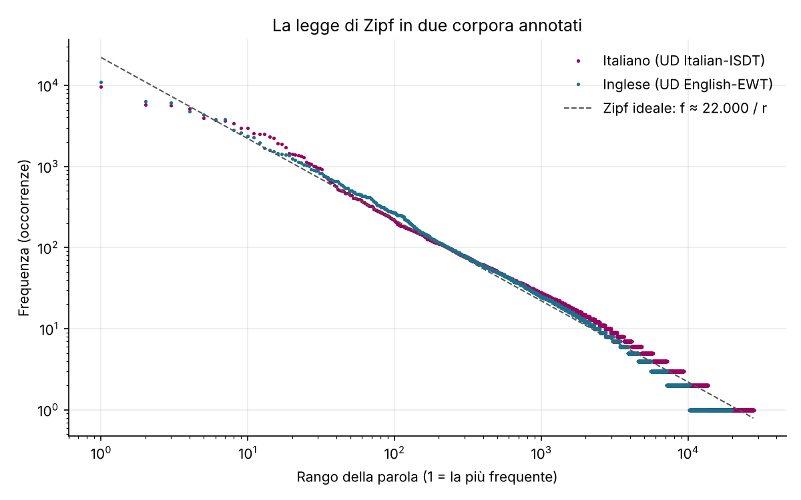
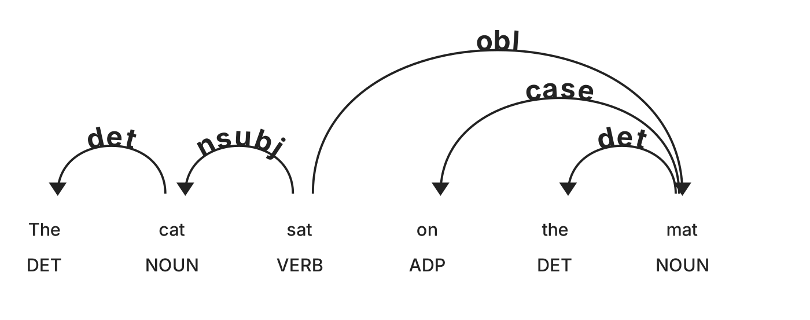
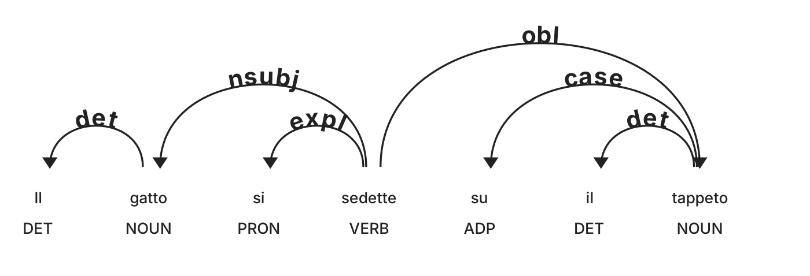
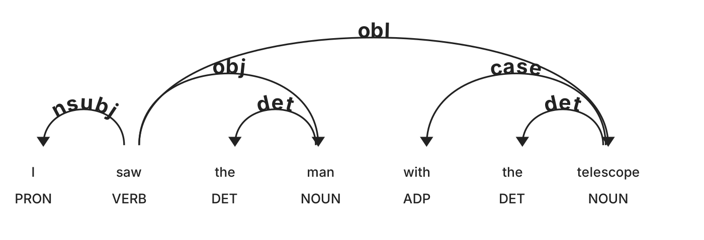
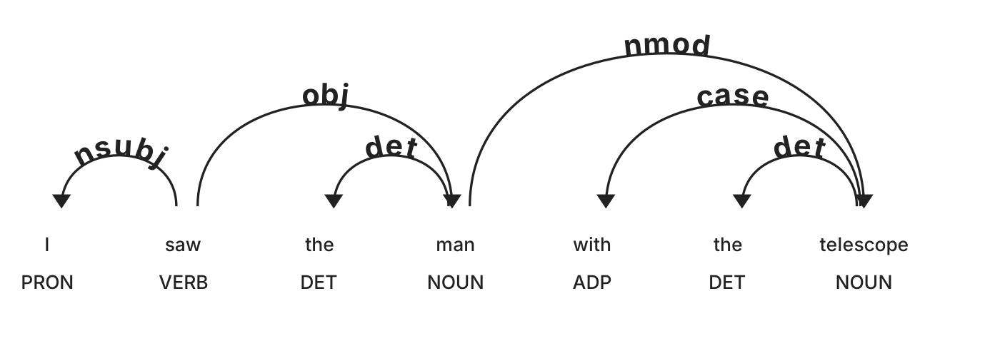
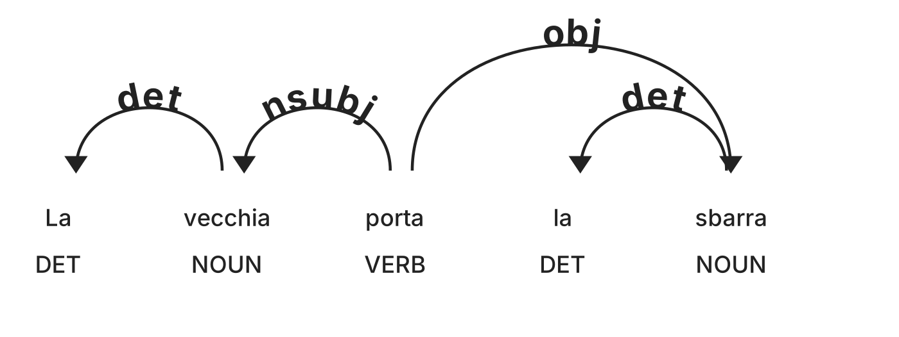
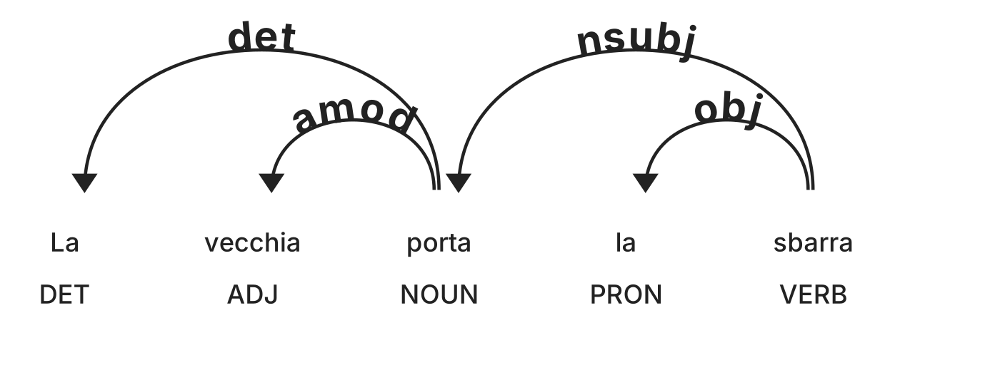

<!-- _class: lead -->
<!-- _paginate: false -->

# Abilità Informatiche 2026/27

## L09 · Il linguaggio come dato

Andrea Schimmenti · Università di Bologna

---

## Di che cosa parliamo oggi

1. **Il corpus**: rappresentatività, bilanciamento, treebank
2. **Dal testo ai token**: tokenizzazione, type e token, lemmi e stem
3. **Contare**: frequenze, legge di Zipf, concordanze, collocazioni
4. **I livelli di analisi**: parti del discorso, dipendenze, Universal Dependencies
5. **L'ambiguità**: il problema centrale del NLP
6. **Voyant Tools** passo passo, su *Pinocchio*

<span class="small muted">Testi: *Le avventure di Pinocchio* (Collodi, 1883) e *The Adventures of Pinocchio* (trad. C. Della Chiesa, 1914), da Project Gutenberg.</span>

---

## Che cosa vede una macchina quando "legge"?

Nella **L04** il nostro programma contava le parole dell'*Infinito* dividendo sugli spazi:

```text
{'sempre': 1, 'caro': 1, 'mi': 1, 'fu': 1, "quest'ermo": 1, ...}
```

*quest'ermo* diventava **una** parola.

Prima di contare, cercare, tradurre o generare un testo, una macchina deve trasformarlo in **dati**.
Oggi seguiamo questo percorso, un passo alla volta.

---

<!-- _class: section -->

# 1. Il corpus

---

## Da una cartella di testi a un corpus

Un **corpus** (L01): testi selezionati con criteri espliciti e organizzati per l'analisi.

- **Rappresentatività**: include la variazione della varietà che vuole descrivere (generi, registri, periodi). Prima si definisce la popolazione, poi si campiona *(Biber, 1993)*
- **Bilanciamento**: proporzioni ragionevoli tra le parti
- **Dimensioni**: più un fenomeno è raro, più testo serve
- **Metadati** (L03) e **annotazione** (L01)

<footer>Biber, D. (1993). Representativeness in corpus design. doi:10.1093/llc/8.4.243</footer>

---

## Alcuni corpora dell'italiano e dell'inglese

| Corpus | Lingua | Dimensioni | Contenuto |
|---|---|---|---|
| **BNC** | inglese britannico | ~100 milioni | scritto e parlato, anni '80–'90 |
| **COCA** | inglese americano | ~1 miliardo | 8 generi, dal 1990 |
| **CORIS/CODIS** | italiano scritto | ~165 milioni | stampa, narrativa, saggistica, prosa giuridica… (UniBo) |
| **PAISÀ** | italiano | ~250 milioni | web con licenza CC, annotato |
| **Google Books Ngram** | molte lingue | centinaia di miliardi | libri digitalizzati |

I primi quattro sono **progettati** da linguisti. L'ultimo è una raccolta nata per altri scopi.

---

## COCA: frequenza per genere e concordanza


<footer>Schermata da english-corpora.org/coca.</footer>

---

## I treebank: corpora annotati fino alla sintassi

**Treebank**: ogni frase ha lemmi, parti del discorso **e** struttura sintattica.
Molto lavoro umano → corpora piccoli, ma sono la base per **addestrare** e **valutare** gli strumenti.

Oggi usiamo due treebank di **Universal Dependencies**:

| | Frasi | Parole | Testi |
|---|---|---|---|
| **UD Italian-ISDT** | ~14.000 | ~245.000 | giornali, testi giuridici, Wikipedia |
| **UD English-EWT** | ~16.600 | ~222.000 | blog, forum, email, recensioni |

Ricordatevi **da dove vengono**: lo vedremo nei numeri.

---

<!-- _class: section -->

# 2. Dal testo ai token

---

## La tokenizzazione

Dividere il testo in **token**, le unità su cui lavorano gli strumenti successivi.

| Fenomeno | Esempio | Token |
|---|---|---|
| Elisione | *l'ho*, *dell'anno* | *l'* + *ho* |
| Preposizioni articolate | *sul*, *della* | *su* + *il* (parole sintattiche) |
| Clitici | *dammelo*, *ammetterlo* | *da* + *me* + *lo* |
| Contrazioni | *don't*, *can't*, *I'm* | *do* + *n't*, *ca* + *n't* |
| Genitivo | *Geppetto's* | *Geppetto* + *'s* |
| Composti | *New York-based*, *e-mail* | dipende |
| Senza spazi | *#nonsonounrobot* | una stringa unica |
| Punti | *U.S.A.*, *3.000* | fine frase o no? |

<span class="small muted">E l'apostrofo `'` (U+0027) non è lo stesso carattere di `’` (U+2019): L02.</span>

---

## Che cosa fa davvero un tokenizzatore (spaCy 3.8)

```text
Dammelo subito: l'ho visto all'ufficio postale, ma non c'è!
Dammelo | subito | : | l' | ho | visto | all' | ufficio | postale | , | ma | non | c' | è | !
```

```text
I don't think New York-based firms can't afford it.
I | do | n't | think | New | York | - | based | firms | ca | n't | afford | it | .
```

- Inglese: la convenzione del **Penn Treebank** → la negazione è sempre `n't`
- Italiano: apostrofi gestiti bene, ma **Dammelo** resta intero (e diventa un… nome proprio)

<!-- Risultati reali dei modelli it_core_news_sm e en_core_web_sm. -->

---

## Type e token

*la gatta e la volpe* → **5 token**, **4 type**

| | Token | Type | Lemmi | Type/token |
|---|---|---|---|---|
| Italiano (ISDT) | 244.547 | 27.782 | 18.675 | 0,114 |
| Inglese (EWT) | 221.724 | 19.639 | 15.114 | 0,089 |

- L'italiano ha **più forme**: un verbo ha decine di forme, in inglese 4 o 5
- Il rapporto type/token **dipende dalla lunghezza**: si confrontano solo testi simili

<footer>Conteggi nostri sui dati di Universal Dependencies, punteggiatura esclusa.</footer>

---

## Lemmatizzazione e stemming

<div class="cols">
<div>

**Lemmatizzazione**: la forma di dizionario

- *andò* → *andare*
- *went* → *go*
- *mice* → *mouse*

Serve il contesto: *porta* nome o verbo? *saw* sega o *see*?

</div>
<div>

**Stemming** (Porter, 1980): taglia i suffissi

- *connected*, *connection* → `connect`
- *university*, *universe* → `univers`
- *casa*, *caso* → `cas`
- *parlare*, *parlamento* → `parl`
- *vado*, *andò* → `vad`, `andò`

</div>
</div>

<footer>Risultati reali degli stemmer Porter (inglese) e Snowball (italiano). Porter (1980), doi:10.1108/eb046814</footer>

---

## Anche il lemmatizzatore sbaglia

| Forma | Lemma assegnato da spaCy | Lemma corretto |
|---|---|---|
| *sedette* | `sedettere` | *sedere* |
| *mangiarono* | `mangiarere` | *mangiare* |
| *Dammelo* | `Dammelo` (PROPN) | *dare* + *me* + *lo* |
| *all'* | `a il` | *a* + *il* |

Pochi passati remoti nei dati di addestramento → il modello **inventa** un infinito per analogia.

**Guardate sempre un campione dei risultati** prima di fidarvi dei conteggi.

---

<!-- _class: section -->

# 3. Contare

---

## Le 20 parole più frequenti



Solo **parole grammaticali** → spesso si escludono con una lista di **stopword**. Ma è una **scelta**: chi studia lo stile o i pronomi ne ha bisogno.

---

## Il corpus decide che cosa vediamo

- Nel treebank italiano, al **100° posto**: *proprietario* (i testi giuridici)
- Nel treebank inglese, tra le prime dieci: *I*, *you*; al 100° posto: *thanks* (forum e recensioni)

<br>

> Le stesse operazioni su corpora diversi danno "italiani" e "inglesi" diversi.

---

## La legge di Zipf

**George K. Zipf** (anni '30–'40): la frequenza di una parola è circa **inversamente proporzionale** al suo **rango**.

<p style="text-align:center;font-size:1.4em"><em>f</em> ≈ <em>C</em> / <em>r</em></p>

| Rango | Italiano | | Inglese | |
|---|---|---|---|---|
| 1 | *di* | 9.695 | *the* | 11.028 |
| 2 | *il* | 5.756 | *to* | 6.294 |
| 3 | *e* | 5.610 | *and* | 6.108 |

La seconda parola: poco più della **metà** della prima. La terza: circa un **terzo**.

---

## Zipf in scala logaritmica: una retta



<footer>Elaborazione nostra su UD Italian-ISDT e UD English-EWT. Ogni tacca vale 10 volte la precedente.</footer>

---

## Che cosa ne consegue

- **Poche parole fanno quasi metà del testo**: le prime 100 coprono il 43% (it) e il 47% (en) dei token
- **La maggior parte delle parole è rara**: circa **metà** dei type compare **una volta sola** (*hapax legomena*: 51% it, 48% en)
- **Nessun corpus è abbastanza grande**: ci sarà sempre una parola mai vista *(→ L13)*

<br>

Perché? Zipf parlava di "minimo sforzo". La questione è ancora aperta *(Piantadosi, 2014)*.

<footer>Piantadosi (2014), doi:10.3758/s13423-014-0585-6</footer>

---

## Concordanze (KWIC)

Righe reali per *make* nel treebank inglese:

```text
    some reliable bearded guides to |  make  | sure you have everything set
               I will come over and |  make  | the change at your desk
              Any tips or advice to |  make  | this a great experience ??
             The outward appearance | makes  | you think this place is
         the Enron guaranties to be |  made  | in support of EPMI 's
            to hear the same leader | making | opposite statements in Arabic to
```

Le prime concordanze, sulla Bibbia, sono del Duecento. Con il computer è cambiata la **scala**.
Per chi traduce: le costruzioni **reali**, che il dizionario spesso non registra.

---

## Una concordanza in CORIS


<footer>Schermata da corpora.ficlit.unibo.it.</footer>

---

## Collocazioni

Combinazioni preferite dall'uso, più frequenti di quanto ci si aspetterebbe per caso:

- *strong tea*, non \**powerful tea*
- *pioggia battente*, non \**pioggia picchiante*
- *prendere* una decisione / *make* a decision
- Nel treebank inglese: *make* + *decision*, *sense*, *change*; *do* + *job*, *work*, *research*

Si misurano con un **punteggio di associazione** (*mutual information*, *log-likelihood*, *logDice*…): misure diverse → classifiche un po' diverse.

> *"You shall know a word by the company it keeps"* (J. R. Firth, 1957) → **L10**

---

## I collocati di *tea* in COCA


<footer>Schermata da english-corpora.org/coca.</footer>

---

## Le frequenze nel tempo: Ngram Viewer


**Cautela** *(Pechenick et al., 2015)*: una copia per libro, e una quota crescente di **testi scientifici**. Molte "tendenze" riflettono il corpus, non la lingua.

<footer>Schermata da books.google.com/ngrams · doi:10.1371/journal.pone.0137041</footer>

---

<!-- _class: section -->

# 4. I livelli di analisi

---

## Le parti del discorso: 17 etichette universali

| Tag | | Tag | |
|---|---|---|---|
| `NOUN` | *burattino*, *puppet* | `ADP` | *di*, *with* |
| `PROPN` | *Geppetto* | `DET` | *il*, *the* |
| `VERB` | *scappò*, *ran* | `PRON` | *lo*, *she* |
| `AUX` | *ha*, *will* | `CCONJ` / `SCONJ` | *e* / *perché* |
| `ADJ` | *vecchio*, *wooden* | `NUM` | *cinque* |
| `ADV` | *subito*, *quickly* | `PART` | *not* |
| `INTJ` | *ahi* | `PUNCT` `SYM` `X` | *.* *%* … |

Penn Treebank: 36 etichette, **solo per l'inglese** (`NN`, `NNS`, `VBD`…). Universal Dependencies: le **stesse** per tutte le lingue. Genere, numero, tempo → **tratti morfologici** a parte.

---

## Una correzione rispetto agli anni passati

Nelle slide degli anni scorsi:

- *Il gatto si sedette sul tappeto* con i tag **Penn Treebank** (`DT`, `NN`, `VBD`, `IN`), pensati per l'inglese
- *si sedette* come **un solo token**
- *Sto bene!* → `["Sto", " ", "bene", "!"]`: lo **spazio** contato come token

Oggi: *si* (`PRON`) + *sedette* (`VERB`), *sul* = *su* (`ADP`) + *il* (`DET`). Gli spazi **separano** i token.

---

## Il formato CoNLL-U

Una frase reale di UD Italian-ISDT:

```text
# text = Ma noi non vogliamo ammetterlo.
ID    FORMA       LEMMA      UPOS    TESTA  RELAZIONE
1     Ma          ma         CCONJ   5      cc
2     noi         noi        PRON    5      nsubj
3     non         non        ADV     5      advmod
4     vogliamo    volere     AUX     5      aux
5-6   ammetterlo  _          _       _      _
5     ammetter    ammettere  VERB    0      root
6     lo          lo         PRON    5      obj
7     .           .          PUNCT   5      punct
```

Una **tabella** (L03). La riga `5-6` risolve il problema dei **clitici**.

---

## L'analisi a dipendenze

Ogni parola dipende da una **testa**, con una **relazione**. Il verbo principale è la **radice**. Il risultato è un **albero** (L03).




---

## Le relazioni principali

| Relazione | Significato | Esempio |
|---|---|---|
| `nsubj` | soggetto | *cat* → *sat*, *gatto* → *sedette* |
| `obj` | oggetto diretto | *lo* → *ammetter* |
| `obl` | complemento preposizionale del verbo | *tappeto* → *sedette* |
| `nmod` | complemento di un nome | *di Pinocchio* → *naso* |
| `det` / `amod` | determinante / aggettivo | *il* → *gatto*, *vecchio* → *falegname* |
| `case` | preposizione | *su* → *tappeto*, *on* → *mat* |
| `aux` | ausiliare | *vogliamo* → *ammetter* |
| `expl` | pronome senza ruolo argomentale | *si* in *si sedette* |

Stessa struttura in italiano e in inglese: le somiglianze **visibili**, le differenze **reali**. Più di **150 lingue**.

<footer>de Marneffe et al. (2021). Universal Dependencies. doi:10.1162/coli_a_00402</footer>

---

## UDPipe: un parser nel browser


Scegliete il **modello** (lingua e treebank), incollate il testo, *Process input*.

<footer>lindat.mff.cuni.cz/services/udpipe · Università Carlo di Praga.</footer>

---

## UDPipe: l'albero


<footer>Scheda "Show trees". Schermata da lindat.mff.cuni.cz.</footer>

---

<!-- _class: section -->

# 5. L'ambiguità

---

## Il problema centrale del NLP

Per noi l'ambiguità passa **inosservata**: contesto e conoscenza del mondo scartano le letture assurde.
Una macchina deve **scegliere esplicitamente**.

**Lessicale**: *porta*, *pesca*, *saw*, *bank*

> *Time flies like an arrow; fruit flies like a banana.*

spaCy analizza le due frasi **nello stesso modo** (*flies* verbo, *like* preposizione):
"la frutta vola come una banana".

---

## Ambiguità sintattica: chi ha il cannocchiale?




Il parser ne sceglie **una** (spaCy: la seconda, anche per *Ho visto un uomo con il binocolo*) e non segnala l'altra.

---

## *La vecchia porta la sbarra*

<div class="cols">
<div>



"La donna anziana porta la sbarra"

</div>
<div>



"La porta vecchia la sbarra"

</div>
</div>

spaCy: *vecchia* `ADJ`, *porta* `NOUN`, *sbarra* `NOUN` → una frase **senza verbo**. Sceglie l'analisi più probabile secondo i suoi dati, senza alcuna idea della scena.

---

## Altre ambiguità

- **Frasi che portano fuori strada** (*garden path*): *The old man the boat* ("gli anziani formano l'equipaggio")
- **Referenziale**: *Geppetto disse a Pinocchio che lui sarebbe tornato presto*. Chi?
- **Di ambito**: *Every student read a book*. Lo stesso libro?
- **Pragmatica**: *Puoi aprire la finestra?* Domanda o richiesta?

→ Traduzione automatica (**L10**), modelli linguistici (**L13**)

---

<!-- _class: section -->

# 6. Voyant Tools, passo passo

---

## Voyant Tools


**voyant-tools.org**: gratuito, nel browser, niente da installare (Sinclair e Rockwell)

1. Incollate gli indirizzi dei due testi, uno per riga
2. **Reveal**
3. Voyant crea un **corpus** di due documenti

<span class="small muted">I file di Gutenberg hanno intestazione e licenza in inglese: per un'analisi seria vanno tolte. È **preparazione dei dati**.</span>

---

## Il cruscotto


**Cirrus** · **Reader** · **Trends** · **Summary** · **Contexts**. Le icone in alto in ogni pannello: cambiare strumento, esportare, impostazioni.

---

## Summary: originale e traduzione


Token (*words*), type (*unique word forms*), *vocabulary density*, lunghezza delle frasi, **parole distintive** di ciascun documento.

---

## Cirrus, Terms e le stopword

<div class="cols">
<div>


</div>
<div>


</div>
</div>

Stopword applicate in automatico secondo la lingua: si cambiano dalle **impostazioni**. Per i numeri veri: la tabella **Terms**.

---

## Terms: le frequenze


Frequenza assoluta e relativa, e un piccolo grafico della distribuzione nel testo.

---

## Trends: dove compaiono i personaggi


*fata*, *grillo*, *volpe* lungo il romanzo. In inglese: *fairy*, *cricket*, *fox*.

---

## Contexts e Collocates: il *naso*

<div class="cols">
<div>


</div>
<div>


</div>
</div>

Concordanza di *naso* e parole più frequenti nelle sue vicinanze. E *nose* nella traduzione?

---

## Che cosa Voyant non fa

- Lavora sulle **forme**: *burattino* e *burattini* sono due parole
- Non riconosce le **parti del discorso**: *porta* nome e *porta* verbo sono la stessa parola
- Nessuna analisi sintattica

Per questo servono corpora annotati e strumenti come **Sketch Engine** → **L11**

---

## Chi entra in un corpus

- I corpora generali: soprattutto **scritto**, soprattutto **giornali**
- Parlato, italiani regionali, dialetti: **sottorappresentati** (costano di più)
- I nostri treebank: "italiano" = giornali e leggi; "inglese" = forum e recensioni

Gli strumenti imparano da qui: pochi passati remoti → errori sui passati remoti; addestrati sui giornali → peggiori su WhatsApp o sul parlato.

Più risorse → strumenti migliori → ancora più risorse. **→ L11**

---

## Riepilogo

| Concetto | In una frase |
|---|---|
| Corpus / treebank | Testi selezionati con criteri espliciti / annotati fino alla sintassi |
| Tokenizzazione | Dividere il testo in unità: più difficile di quanto sembri |
| Type e token | Parole diverse e parole totali |
| Lemma / stem | Forma di dizionario / radice ottenuta tagliando suffissi |
| Legge di Zipf | *f* ≈ *C* / *r*; metà dei type sono hapax |
| Concordanza, collocazione | La parola nel contesto; le sue compagnie preferite |
| PoS e dipendenze (UD) | Parti del discorso e albero sintattico, con uno schema comune |
| Ambiguità | Più analisi possibili: la macchina deve sceglierne una |

---

<!-- _class: lead -->
<!-- _paginate: false -->

## Prossima lezione

# Dalle regole alla statistica: la traduzione automatica

L10 · Georgetown-IBM, ALPAC, traduzione statistica e neurale, *word embeddings*, bias di genere
